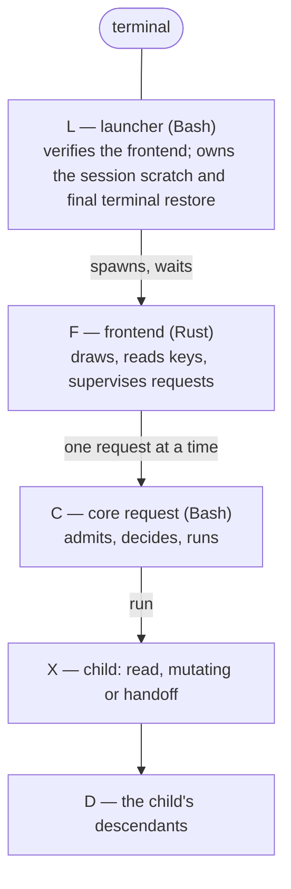

# Records and the core protocol

**Status: Gate 1 and Gate 2 (framing, admission, processes, diagnostics and
the read surface) and the operation-record diagnostic are built; the rest
follows MILESTONES.md → *The finish*.**
Local experiments that ground it are recorded in docs/UPSTREAM.md →
*Experiments*.

Defined here once and used everywhere else: the **record format** every
file and message is written in, how bytes are **admitted** before anything
parses them, the **processes and descriptors** of a frontend session, and
the **actions** the core allows, each bound to what the person reviewed.

## 1. The record format

### Grammar

```text
document = header LF 1*( record LF ) [ seal LF ]
header   = name SP version                   "omb-profile 1"; name a-z and "-", at most 24
record   = type 1*( TAB field )              a record has at least one field
type     = a-z *( a-z / "-" )                at most 24 bytes
field    = key "=" value
key      = a-z *( a-z / 0-9 / "_" )          at most 32 bytes
value    = *( safe / "%" HEXU HEXU )         at most 4096 bytes as written
safe     = A-Z / a-z / 0-9 / "." / "_" / "~" / "/" / ":" / "@" / "+" / "," / "-"
HEXU     = 0-9 / A-F
seal     = "seal" TAB "sha256=" 64( 0-9 / a-f )
```

A document is bytes, and only these bytes: TAB (0x09), LF (0x0A) and
0x20–0x7E. Every other byte — NUL, CR, other controls, DEL, anything above
0x7E — is invalid wherever it appears. **There are no comment lines**: a
document family that needs notes for people has a `note text:text` record
in its schema (the migration map, `data/migration-map.omb`, has one), which
is admitted like any other record.

### One canonical encoding per value

Every value has exactly one written form, so that equal meanings are equal
bytes (which the seals, bases and digests depend on):

- a byte in `safe` is written as itself, never escaped (`%41` is invalid);
- every other byte is written as `%` and two **upper-case** hex digits
  (`%2f` is invalid); `%00` is invalid;
- a record is its type, a TAB, and fields separated by exactly one TAB: no
  leading, trailing or doubled TAB; no blank line; the document ends with
  exactly one LF after its last line;
- **every non-list key the schema lists is present**, in the schema's
  order, once; a key the schema does not list, a record type it does not
  list, or a missing key makes the whole document invalid;
- an optional key (`?`) with no value is written `key=`, which means
  "none"; a key that is not optional never has an empty value;
- a **list** key (`*`, `+`) is the key repeated in order (`arg=-y	arg=pkg`),
  in its place in the schema's order; an empty list is the key absent; an
  element may be empty (`arg=`) only in a `bytes` or `text` list, where it
  is the empty string;
- record order and cardinality are the schema's (`1`, `?`, `*`, `+`, `—`
  for forbidden); unless the schema states another order, records of one
  type are consecutive, in the order the schema table lists the types; a
  duplicate of a record the schema says is unique (the same `id`, say) is
  invalid.

Schemas are written as `record: key:type key:type? key:type*` — `?` optional
(present, and empty for none), `*` a list, `+` a list of at least one — with
the record's cardinality in the document. Every stored and exchanged record
family has its schema table in the document that owns it; the protocol's
own are in §4.

### Value types

| Type | Written form | Decoded meaning |
| --- | --- | --- |
| `uint` | `0` or `[1-9][0-9]{0,17}` | an integer below 10¹⁸, safe in Bash's 64-bit arithmetic |
| `bool` | `0` or `1` | — |
| `enum(a\|b)` | one listed word | — |
| `id` | `[a-z0-9][a-z0-9._:@+-]{0,127}` | an identifier; never contains `%` |
| `hex8`, `hex16`, `hex40`, `hex64` | exactly that many `[0-9a-f]` | display ids (8), short ids (16), Git commit ids (40), full SHA-256 digests (64) |
| `utc` | `YYYY-MM-DDTHH:MM:SSZ` | a time, shown, never compared across systems |
| `text` | percent-encoded | valid UTF-8 with no C0 or C1 control, no DEL, no ESC: safe to render |
| `bytes` | percent-encoded | any bytes except NUL: paths, file names, raw values. **Never rendered raw** |
| `code` | percent-encoded | printable ASCII of at most 512 bytes that matches the grammar of its **kind** (below) |

**Codes.** A `code` value is always read together with its kind, from the
same record (`code kind=…`) or from the declaring `param`; the type never
widens `id`:

| Kind | Decoded grammar | Semantic check |
| --- | --- | --- |
| `token` | `omb2:` then `name=value` fields joined by `,`; names `[a-z]+`; values without `,` or `=` | the baseline's `token_decode`: every name on its whitelist (`enc user host kmap tz loc ssh gh linux shared dev plan`; `prof` is admitted, and no action writes it), each at most once, each value accepted by `cfg_field_ok` |
| `ombdone`, `ombshare` | `<kind>-` 8 hex `-` 12 hex `-` 4 hex, lower case | the baseline's `code_parse`: the last 4 digits are the first 4 hex digits of the SHA-256 of everything before the last `-` |
| `ombbundle` | `ombbundle-` 16 hex `-` 4 hex, lower case | the same check-digit rule; admitted, and no action writes or asks for it |

A code the person types arrives as an `arg` of a `param` whose type is
`code`: the core normalises it as `code_parse` does (upper-case hex folded,
spaces removed) before the semantic check. A code the core writes is already
canonical.

**Display versus data.** `bytes` values (paths above all) are kept
byte-for-byte for every comparison, digest and file operation, and are shown
only through one display function that renders printable UTF-8 as itself
and every other byte as `\xNN`, then truncates. No value of any type is ever
written to the terminal unescaped: a terminal control sequence in a file
name, a log or an upstream message is data, never display.

### Sealed documents

A stored document ends with `seal`: the SHA-256 of every byte before the
seal line, computed with `shasum -a 256` (macOS) or `sha256sum` (Linux). A
seal detects **corruption** — a torn write, a truncated copy, a hand edit —
and nothing more: anyone who can write the file can recompute it. Consent
is a typed word after a review, never a seal. Protocol messages are not
sealed.

### Limits

| What | Limit |
| --- | --- |
| a record (one line, LF excluded) | 16 KiB |
| a value as written | 4 KiB |
| a protocol request | 64 KiB, 512 records |
| a protocol response (the event spool of one request) | 8 MiB, 65 536 records |
| a stored document | its schema's limit; at most 16 MiB (profile, bundle), 64 KiB (every other) |

## 2. Admission: bytes before parsing

Bash's `read` cannot be the first thing to see untrusted bytes: it silently
turns doubled, leading and trailing TABs into the canonical split and drops
or truncates at NUL (reproduced on `/bin/bash` 3.2.57 and Bash 5.3). So every
document the core reads — a request, a profile, a bundle, a qualification
record, the lock, the migration map — passes **admission** first,
using standard tools present on stock macOS and on the fresh Asahi image
(`head`, `wc`, `tr`, `tail`, `od`, `awk`; BSD `awk` on macOS, gawk in the
image and on Omarchy):

1. **Bounded copy.** A stream is copied with `head -c <limit+1>` into a
   private file in the per-run scratch directory; a stored file's size is
   read first (`wc -c`) and a file over its limit is refused unread. Nothing
   is ever read without a bound.
2. **Size.** More than the limit: refused (`too-large`).
3. **Byte class.** `LC_ALL=C tr -d '\011\012\040-\176' <file | wc -c` must be
   0: any NUL, CR, control, DEL or non-ASCII byte refuses the document before
   anything else looks at it.
4. **Termination.** The file is not empty and its last byte is LF (`tail -c
   1 | od -An -tx1`).
5. **Framing and canonical form.** One `LC_ALL=C awk` pass checks every
   line: length, no blank line, no leading, trailing or doubled TAB, type and
   key grammar, value grammar, upper-case escapes, no `%00`, no escaped safe
   byte, record count. Its input is now NUL-free ASCII, which both awks treat
   alike.
6. **Only then** Bash splits lines on TAB and fields at the first `=`, and
   validates each record against its schema (order, cardinality, types, and
   for a response, one `result` as the last record). At this point splitting
   can no longer normalise anything, because every input it would normalise
   was refused.

**Every tool's status counts.** Each step captures the exit status of every
stage of its pipeline in the first assignment after it (`PIPESTATUS`), and
any tool that fails refuses the document (`io`), so a failed read can never
look like an empty or valid document.

Each refusal carries one **reason code**, decided by the first check that
fails, in the order of the steps above; within step 5, lines are checked from
the first, and within a line in this order: `line` (too long), `blank`,
`tab`, `header` (the first line only), `key` (type or key grammar, including
a line with no TAB, such as a `#` line), `value`, `nul-escape`,
`non-canonical`, and `too-large` at the first record past the document's
record limit. Step 1 or any tool failure gives `io`, step 2 `too-large`,
step 3 `byte`, step 4 `eof`, step 6 `schema`, `type` (a value that breaks
its type or its code kind), `after-result` (a record after the `result`) or
`result` (none, or two); a seal check gives `seal`.

The frontend admits the core's responses with the same rules in Rust,
directly on bytes. The two implementations are held together by a
differential corpus (docs/TESTING.md → `proto-diff-*`): every case is
admitted or refused identically by both, with the same reason code.

## 3. Processes and descriptors

This section is the only description of the session's process model;
docs/FRONTEND.md refers to it.

### The processes



Two kinds of process, never confused:

- **Controllers** — the launcher L, the frontend F, and the session's cores C.
  Each is recorded by its identity (below) and expected to stay alive while
  its work goes on.
- **Workers** — the child X that C starts for a request, and every process
  that descends from it. Workers do the work; controllers only start,
  supervise and judge it.

All of them share the shell job's process group: nobody calls `setpgid` or
`setsid` (a static check on F and C), so the terminal's signals reach them
together during a handoff. The group therefore never becomes empty while a
controller is alive, and emptiness is never a test for anything. What a
worker that makes its own group (`sudo` with `use_pty`, a daemon) means is in
*Operations and exclusion*. F runs one request at a time.

**A process's identity** is its PID, its start time, and the machine's boot
session:

| | Start time | Boot session |
| --- | --- | --- |
| Bash (L, C, a later launcher) | `ps -p <pid> -o lstart=` (the baseline's `_proc_started`), to the second, on both systems | `/proc/sys/kernel/random/boot_id` (Linux), `sysctl -n kern.bootsessionuuid` (macOS) |
| Rust (F) | `/proc/<pid>/stat`'s start time (Linux); `proc_pidinfo` with `PROC_PIDTBSDINFO` (macOS) | the same two sources |

Each identity is compared only with one recorded by the same method. A
recorded process is alive only if a process with that PID exists now, with
that start time, in that boot session; a reused PID is never taken for the
recorded process. **When an identity cannot be established** — `ps` fails,
the boot session cannot be read — the process counts as possibly alive:
nothing is deleted and no barrier is cleared on the strength of it.

**The group snapshot.** Immediately before starting a child, C records the
identities of every process then in the job's process group (the process
table read directly: `ps -axo pid=,pgid=,lstart=`). Its **workers still
present** are the processes in the group now that are not in that snapshot
and are not the reader's own direct children at that moment — the `ps` and
the pipeline stages taking the reading, which are not workers (the child
itself has already been waited for, and a worker it left behind is
reparented, never C's child). F keeps the same snapshot, from its own
reading, before it hands the terminal to a request; L uses the same rule,
with the moment it wrote `launcher.omb` as its snapshot, for its own
cleanup.

### The session scratch

L creates a private directory, `mktemp -d "${TMPDIR:-/tmp}/omb-session.XXXXXX"`
(0700), and passes its path as `OMB_SESSION_DIR`. In it, each written with
exclusive creation (0600):

| File | Written by | Holds |
| --- | --- | --- |
| `launcher.omb` | L, first | L's identity |
| `frontend.omb` | L, right after spawning F | F's identity |
| `session.diag-summary` | L, with the scratch | the session's diagnostics summary (*Diagnostics, by child class*) |
| `req-<n>.events` | F, before spawning C | the request's event spool |
| `req-<n>.core` | C, at start; removed at exit | C's identity |
| `req-<n>.worker-<k>` | C, as it starts each child | that child's identity |
| `req-<n>.diag`, `req-<n>.diag-summary` | C, when a read child's output is first kept | retained diagnostics (*Diagnostics, by child class*) |

L starts F as `omb-tui --session <dir>`, so a live frontend can be found by
its arguments even before `frontend.omb` exists.

**Owner cleanup.** When F has exited, L — alive, performing its own normal
exit, and exempt from its own check — removes the scratch only when all of
these hold; otherwise it leaves the scratch for a later launcher:

- F is gone (L waited for it);
- no `req-*.core` names a live core;
- no `req-*.worker-*` names a live worker, and no process that entered the
  job's group after L wrote `launcher.omb` remains, other than L itself and
  the reading's own processes;
- no unresolved operation record in the state directory names this session.

For the startup check, L also reads its own session's spools before it
removes them, to decide the check's outcome (docs/FRONTEND.md → *The
startup check*); it reads nothing else in the scratch for that.

**Stale reclaim.** A later launcher that finds an old `omb-session.*`
directory has no exemption. It removes the directory only when:

- the identity in `launcher.omb` is not alive;
- the identity in `frontend.omb` is not alive, and no live process's
  arguments name the directory (`ps -axo pid=,args=`), which covers a
  frontend that started before `frontend.omb` was written;
- no `req-*.core` and no `req-*.worker-*` names a live process;
- no unresolved operation record names the session;
- every one of these identities could be established; any that could not
  counts as alive.

A launcher PID that is gone is never enough. The scratch is temporary, not
persistent state, and is never read by a later session except to decide
whether it may be removed.

### Descriptors

| Descriptor | L | F | C | X, read | X, mutating | X, handoff | D |
| --- | --- | --- | --- | --- | --- | --- | --- |
| 0 | terminal | terminal | managed: `/dev/null`; handoff: terminal | `/dev/null` | `/dev/null` | terminal | as X |
| 1, 2 | terminal | terminal | managed: `/dev/null` (in fixture mode, `req-<n>.core-err`, for tests); handoff: terminal | as the child registry says (*Children*): functional output to its bounded destination, diagnostics to C's drain | `/dev/null`, or a functional destination the registry names | terminal | as X |
| 3 | — | the request pipe's write end, close-on-exec; closed as soon as the request is written | the request pipe's read end; read to EOF (bounded) and closed with `exec 3<&-` before anything else runs | never open | never open | never open | never open |
| the event spool | — | a read-only handle on `req-<n>.events`, close-on-exec, in a reader thread | **no descriptor held**: each record is appended with `printf … >>"$OMB_EVENTS"`, which opens, writes and closes | never open | never open | never open | never open |
| anything else | none | every descriptor F inherited beyond 0–2 made close-on-exec at its start — each one the kernel lists (`/proc/self/fd`, `libproc`'s descriptor list), with no numeric ceiling; one that cannot be sealed stops F before any core starts — and every descriptor Rust's standard library opens is close-on-exec; fd 3 is placed with `dup2` in the child just before `exec` | Bash's own script descriptor is close-on-exec | — | — | — | — |

There is no response pipe (no fd 4) and no child-status pipe: responses go
to the spool file, F learns that C has ended from `waitpid`, and C learns
the same of its children from `wait`. Everything C knows how to report
travels as a record; C writes nothing else.

Consequences, each tested (docs/TESTING.md → `sup-*`):

- no protocol descriptor exists in any child or descendant, so none can hold
  a pipe open, write into the protocol, or block on it;
- F opens descriptors and spawns only on its main thread (the reader thread
  only reads its already-open handle), so macOS, where the standard library
  sets close-on-exec on a new pipe in a second step, has no window in which
  another spawn could inherit it; C appends records only from its main
  shell, never inside a background job or a pipeline stage;
- the request pipe's EOF depends only on F closing its write end;
- the end of a response is **C's exit** (F waits for it) plus **exactly one
  `result` record as the last complete line of the spool**, never an EOF that
  a descendant could delay — and never a read of the spool that failed: that
  ends the reading with its error, and the outcome, once C has exited, is
  unknown, however whole the bytes before it looked.

### A request's life

1. F creates the pipe and the spool, then spawns C with the descriptors
   above and the environment of §4 → *Environment*.
2. C writes `req-<n>.core`, loads its libraries, copies fd 3 through
   admission step 1 (bounded) and closes it. An over-long request makes
   `head` stop reading; F's write then fails with EPIPE, which F treats as a
   refusal.
3. C appends `hello`, then its records, then one `result`, removes
   `req-<n>.core`, and exits.
4. F's reader thread follows the spool continuously — during a handoff too,
   because it never touches the terminal — and passes each complete, admitted
   line to the main thread through a bounded channel. When C has exited, the
   reader drains the rest and checks that the last line was a `result`.
5. F shows `req-<n>.diag`, if any, on the session's log screen.

### Children

Every program C runs has an entry in the core's reviewed **child registry**
(`data/children.omb`), keyed by the action and the command; a request never
chooses any of it:

| Field | Values |
| --- | --- |
| `class` | `read`, `mutating`, `handoff` |
| `stdout`, `stderr` | `functional` (the output is the work: read by the core with its own bound, or written to the artifact the action creates), `diagnostics` (read class only), `null` |
| `tty` | `none` (runs correctly with no terminal and no one reading its output) or `needs` (it prompts, asks, shows progress the person must see, or changes behaviour when `isatty` is false) |
| `detaches` | `no` (it never leaves anything running after it exits), or `owned` (it deliberately leaves a service behind, and the entry names the action-specific owner and completion check) |

Rules, each a static check (docs/TESTING.md → `diag-class-static`,
`diag-mutator-tty-class`, `sup-mutating-daemon-classification`):

- `tty=needs` is always `class=handoff`; `class=mutating` requires `tty=none`;
- a mutating child's streams are `null` or `functional`, never
  `diagnostics`, so no pipe or growing diagnostic file sits inside a
  mutation;
- a child whose effect runs on after it exits is `detaches=owned` with its
  owner and check, or it is not run managed at all;
- functional output is never subject to the diagnostic budgets below, and
  diagnostics are never functional: the qualification data, an export's
  objects, and anything the core parses are functional, with their own
  bounds in the documents that own them.

### Diagnostics, by child class

| Class | Output | Outcome judged by |
| --- | --- | --- |
| **read** | stderr, and stdout when the registry says `diagnostics`, through a pipe into the drain below | its exit status, captured first from `PIPESTATUS`, and what the core read |
| **mutating** | `/dev/null`, or the functional destination the registry names: no pipe, nothing that can fill, block, or end the child | its exit status and the machine read afterwards (the postcondition); the command itself is shown so the person can run it by hand to see its output |
| **handoff** | the terminal, never captured | the machine read afterwards |

**Every retained byte counts.** The limits below are over everything kept —
headers, payload, markers and summaries — with no exception, and no file
ever exceeds its limit:

| Scope | Hard limit | Made of |
| --- | --- | --- |
| a child | 65 536 bytes | one header line of at most 256 bytes (the command's registry id, its exit status, the bytes kept, whether any were discarded), then at most 65 280 bytes of its output |
| a request | 262 144 bytes | `req-<n>.diag` (at most 262 016 bytes of child blocks) and `req-<n>.diag-summary` (exactly 128 bytes) |
| a session | 4 194 304 bytes | every request's two files and `session.diag-summary` (exactly 128 bytes) |

- **The drain is bounded while the child runs.** A read child's diagnostic
  output goes to `tail -c 65281`, which reads everything, holds at most the
  last 65 281 bytes in memory, and writes them to one temporary file only
  when the output ends: the temporary file never exceeds 65 281 bytes, and
  is removed once merged. F runs one request at a time and C runs its
  children one at a time, so at most one such file exists.
- **Reserve before append.** Before starting a read child, C computes the
  room left: the child's 65 536, the request's 262 016 less `req-<n>.diag`'s
  size, and the session's 4 194 304 less every diagnostic file's size and
  less the 128 bytes a new request's summary would need. When the child
  ends, C appends one block of at most that room: the header, then the
  **last** bytes of the output that fit. The 65 281st byte, or a cut to fit
  the room, marks the block as discarded. Nothing is appended and then
  trimmed.
- **Saturation.** When the room is less than a header and one byte, C does
  not start a drain that keeps anything: the child's output goes through
  `cat >/dev/null`, which consumes it so the child never blocks, and C
  records the child in the summary instead. A request whose file would need
  room the session lacks creates no file at all. A saturated request or
  session stays saturated: no header, marker or file is added for later
  children.
- **Summaries are fixed size.** Each summary is exactly 128 bytes: the words
  "diagnostics truncated", the children not kept and the bytes discarded as
  fixed-width ten-digit counters that stop at 9 999 999 999, rewritten whole
  (temporary file, then rename) as they change. They never grow.
- **Discarding keeps draining.** `tail` and `cat` read to the end, so a noisy
  read child is never blocked by its drain. If the drain itself fails
  (killed, or the final write finds the disk full), the read child may
  receive SIGPIPE; the diagnostics are "not available", and the read is
  judged by its own status and functional output, failing only if that is
  lost.
- **A capture failure changes no outcome.** Diagnostics that cannot be kept
  never turn a result into a failure, never authorise a retry, and never
  stand in for a postcondition; a mutating child has no diagnostics to lose.
- **Raw and temporary.** Diagnostics are raw output, potentially sensitive:
  they stay in the scratch, are shown only on the log screen, are removed
  with the scratch, and never enter the `debug` report. The scratch is not
  a security boundary and removal is not secure erasure.

### Backpressure and bounds

- **C never waits on F.** Its output is a file, so however slowly F reads, C's
  writes complete; nothing on a mutation path depends on the frontend
  keeping up, and no mutating child has a diagnostic pipe.
- C counts what it writes. Past 8 MiB less 64 KiB it writes no more
  `progress` or `message` records, one `overflow` record with the number
  suppressed, and then its `result`.
- F's channel holds 1 024 records; when it is full the reader thread waits,
  which slows only the reader. F keeps the latest `progress` per action and
  at most 500 `message` records per request.
- A spool larger than 8 MiB, a line over 16 KiB, or an unterminated last line
  when C has exited is a protocol error: the outcome is **unknown**.

### The terminal result

Every response ends with exactly one `result`, after every other record.
What follows it decides the reason: a complete record after it is
`after-result`; bytes after its LF with no final LF are `eof`, because
termination (admission step 4) is checked before the order of records
(step 6). Either way it is a protocol error. If C exits without a `result`,
or the spool fails admission, **the outcome is unknown**: F shows "the core
stopped without a complete answer", never "failed" or "nothing happened",
and asks for a fresh snapshot, which re-derives the machine's state; for an
act request, the scope's operation record decides what must be reconciled
(*Operations and exclusion*).

### When something dies

| Event | What happens |
| --- | --- |
| F dies (panic, kill) during a request | C continues to its end — its writes go to a file, so nothing fails — and exits. L sees F exit (its own child, waited for whether or not `frontend.omb` was written), then waits while any recorded core or worker is alive (a handoff child may still own the terminal) and until nothing that joined the group since `launcher.omb` remains; only then does it restore the terminal settings it saved, leave the alternate screen, show the cursor, report that the interface stopped and what to run to see the machine's state, and clean up as the owner if it may. Still running at the wait's limit, or an identity or the process table that cannot be read: L leaves the terminal and the scratch as they are, says so and exits 1 |
| C dies (crash, kill) | its workers continue. F sees C exit without a `result`: outcome unknown. For an act request, its operation becomes **unsupervised** (*Operations and exclusion*). After a handoff request, F does not take the terminal back while any worker is still present — a process in the group that is not in F's snapshot from before the request (F reads the process table directly — `/proc` on Linux, `libproc` on macOS — spawning nothing; a process it cannot read counts as present, and one whose start it cannot read matches nothing); then it re-enters and re-derives. A table it cannot read at all leaves the terminal the child's: F exits, and L decides |
| F cannot read C's state (`waitpid` fails) | C may still be running and nothing will say when it ends: the request is lost, F starts no further request, and during a handoff it leaves the terminal as it is and exits; L decides |
| L dies | F continues and restores its own terminal when it exits; the scratch stays until a later launcher may reclaim it |
| X dies | C sees the exit status, reads the machine afterwards, and reports what the machine shows (the baseline's rule) |
| EPIPE | only the request pipe and a read child's drain exist: F writing an over-long request, or to a C that already exited, is a refusal; Rust ignores SIGPIPE by default and sees EPIPE as an error. A mutating child has no diagnostic pipe |
| F's reader thread dies, or a read of the spool fails | a panic stops at the thread's boundary and never restores the terminal (only the main thread owns it); the main thread sees the reader's verdict, or its channel close; nothing ends before C exits, and then the outcome is unknown and the state is re-derived |
| a worker outlives its parent, or leaves its process group | for a read request, nothing is held for it; for an act request, *Operations and exclusion* |
| a signal interrupts a read or wait | the call is retried; signals change behaviour only as the next table says |

### Signals

| Signal | Idle, frontend drawing | During a handoff |
| --- | --- | --- |
| Ctrl-C | a key (raw mode): F quits when idle, clears a text field, or cancels a cancellable managed request | SIGINT to the process group: L and F **catch** it with a handler (never ignore it, so the child's disposition after `exec` is the default); C keeps the baseline's handling for a launched command; X and D act on it as their authors intended |
| Ctrl-Z | a key: F restores the terminal, stops the whole group (`kill(0, SIGTSTP)`), and on SIGCONT re-enters and re-derives; refused while a request runs | SIGTSTP to the group: everything stops and continues together |
| SIGTERM, SIGHUP to F | a flag: F cancels a cancellable request, waits for a non-cancellable one to end, restores the terminal and exits | the same, after the child ends |
| SIGQUIT | caught by L and F like SIGINT | as SIGINT |

L, F and C never set any of these to "ignore", never block them across a
`spawn`, and start every child with the default signal mask (a static
check, and PTY tests of the actual dispositions).

### Operations and exclusion

The baseline's run lock stays exactly as it is: one recording run at a time,
cleared when its owner process is gone. It is not enough on its own when a
mutating worker can outlive the core that started it, so every **act**
action that changes the machine also keeps an **operation record**,
`ops/<scope>.omb` in the state directory:

- **Written before the effect**, with the baseline's checked writer (a
  record that cannot be written stops the action, as `state_must_set`
  does): the action, its scope, its full basis digest, the session, C's
  identity (with the boot session), and `at`, when the operation began: a
  rewrite of the same operation (unsupervised, failed) keeps it. Only a
  scope's own record speaks for it: one whose scope field names another
  scope, or whose action is not one of the scope's, is read as a record
  that cannot be read, never reconciled by that other action's judgement.
- **Normal supervised completion.** Only the core that wrote it removes it,
  and only when all of these hold, in this order:
  1. C started the child the registry names for the action, and has been
     alive and supervising throughout;
  2. the child exited (C waited for it);
  3. **worker quiescence**: no worker is still present — every process in
     the group is one C's snapshot held before the child started, which is
     where the controllers L, F and C are, and they are expected to remain;
  4. for a child the registry marks `detaches=owned`, its action-specific
     completion check holds;
  5. the action's postcondition holds on a fresh read;
  6. the result is recorded where the scope keeps results (the Shared
     creation record, the restore run log, the install classification, the
     qualification step).
  If workers are still present when the action's time limit passes, or the
  process table cannot be read, C cannot establish quiescence: it marks the
  operation unsupervised (below) and reports the outcome unknown.
- **Why generic inspection is enough, and where it stops.** A worker that
  leaves the group (`setsid`, a double fork) is invisible to the snapshot.
  So the registry is the guarantee: a managed mutating child must be
  `detaches=no` — a program that leaves nothing running — or
  `detaches=owned` with its own owner and check; a program that may detach
  in a way no check can follow is run as a handoff, or not at all. Adding or
  changing an entry is a reviewed change, and a static check refuses a
  managed mutating entry the registry marks as detaching without an owner
  (docs/TESTING.md → `sup-mutating-daemon-classification`). Process-group
  inspection is never claimed to prove that an arbitrary daemon has stopped.
- **Kept as failed when the effect is not there.** When 1 to 4 hold — C
  supervised throughout, the child exited, no worker present, any owned
  check done — but the postcondition does not hold on the fresh read, the
  action ended and the machine does not show its effect. Unless the scope's
  classifier proves that nothing changed (*Executing*, step 8), C does not
  remove the record: it rewrites it as `state=failed`, with what the read
  showed (`finding=absent`: its effect is not there; `finding=unexpected`:
  something else is), as a new file renamed over the old one, so a record
  that cannot be rewritten leaves the running one, which becomes
  unsupervised once C has exited — never none. Then it records the result
  where the scope keeps results and answers `failed`; a result that cannot
  be recorded leaves the failed record in place. A failed record is a
  **barrier**: every act action in its scope is refused (`code=unresolved`),
  saying that the operation ended but the machine does not show its
  expected effect — never that it may still be running — and naming the way
  forward; read commands keep working and show it. Nothing in this boot
  clears it, not a matching postcondition; it is reconciled after a new boot
  as an unsupervised record is (below).
- **Unsupervised when supervision is lost.** A record, other than a
  failed one, whose core is no longer alive, or one C itself marks
  unsupervised, means the outcome is unknown and a mutating worker may
  still be running, even one that left the group. An unsupervised record
  is a **barrier**: every act action in its
  scope is refused (`code=unsupervised`), naming the operation and the one
  way forward, for the rest of this boot. Nothing in this boot clears it:
  not an empty-looking group, not a matching postcondition.
- **Cleared only by a new boot, then reconciled.** Once the current boot
  session differs from the record's — an unsupervised or a failed one — no
  process of the old boot can still run. Then the scope's classifier runs
  (the baseline's creation-record check, restore's judgement of each item,
  a fresh classification) and records one of three findings:
  **no effect**, **the expected effect, completed**, or **something
  unexpected**. The first two remove the record; the third keeps the scope
  blocked, shows what the machine holds, and needs the person. A reboot is
  never itself counted as success. Read commands keep working throughout,
  and show the barrier and "restart this Mac (or this Linux system), then
  run the tool again".
- **Unreadable: no boot clears it.** A record that exists but cannot be
  admitted gives none of the fields the judgements above start from, so it
  is a barrier for every act in its scope, in this boot and every later
  one, while read commands keep working. What may be concluded from it, how
  it is inspected and on what terms it may be cleared: *An operation record
  that cannot be read*.
- **Honoured by both interfaces.** The act entry of every command, in the
  frontend and in the text interface (`--no-tui`), checks the operation
  records of its scopes first. In text, under the run lock and before the
  flow reads anything, `op_text_barrier` (`lib/operation.sh`) checks the
  scopes that command's flow may change (on macOS, install: plan, asahi,
  shared; on Linux, install and resume: network, omarchy, shared; `dev`:
  omarchy; `plan`, `shared`, `profile`, `export`: their own). An earlier boot's
  record is reconciled by its row's judgement, as the core does. Any other
  record stops the command, in the core's words. A dry run changes nothing
  and is not held.
- **Read requests hold nothing.** A read worker that outlives its core is a
  non-mutating orphan: it can write only its bounded diagnostics into the
  scratch, and it never creates or holds a barrier.
- This is not a disk lock: the scope's own postconditions and records remain
  the authority for what happened, as the baseline's creation record is for
  Shared.

### An operation record that cannot be read

Every judgement in *Operations and exclusion* starts from the record's
fields; a record that exists and cannot be admitted gives none, so failing
to read it never means that nothing runs, that it ended or left no effect.

- **It blocks its scope.** Every act in the scope is refused at step 3 of
  *Executing*, before any effect (`refused unsupervised`: the record
  cannot be read, and a restart does not change that), and the scope's
  snapshot lists none of its act actions. No reboot, read or time clears
  it. The launcher's owner cleanup and stale reclaim count it as naming
  every session, so no session scratch goes while it is there.
- **Reads keep working**, and `operation SCOPE` (in fixtures also the
  snapshot and `detail kind=operation`) shows what can be established
  without trusting the bytes (*The operation-record diagnostic*, §4).
- **`operation clear SCOPE` is the way out**: an act command of the text
  interface for the person at the machine, taking the scope names
  `operation SCOPE` takes. No core action stands for it and the frontend
  never offers it; the act refusal and the diagnostic's next step name it.
  In order:
  1. It takes the run lock, as every act command does, and stops while
     another run, the record's own live core among them, holds it. Under
     `--dry-run` it takes none and shows what it would move.
  2. It inspects the record as `operation SCOPE` does and shows the
     finding; only `unreadable` goes on. No record: nothing to do, exit 0.
     A readable record is refused with its own way forward, an
     `undetermined` one with its failed step: nothing uninspected moves.
  3. It says what it cannot know — whether a process this tool started
     still runs, and what the operation changed — and that a restart ends
     every such process, then asks for the typed word `clear`. Anything
     else, or the end of input, stops it.
  4. It inspects again and is refused as changed unless the entry is the
     one shown: kind, device and inode, and for a plain file size and
     fingerprint.
  5. One rename inside `ops`, to `<scope>.omb.unreadable-YYYYMMDDTHHMMSSZ`
     (UTC): whatever its kind, the entry is never opened, followed,
     copied, edited or deleted; the name ends in no `.omb`, so no reader
     takes it for a record; a name already taken is refused. It is logged.
  6. It reports where the entry is kept, its kind, size and fingerprint,
     that nothing else changed and that this shows nothing about what the
     operation did: exit 0 (1, saying so, if the kept entry's device and
     inode are not the ones checked).

  Every refusal moves nothing and exits 1; a bad argument exits 2 first.
  It writes no operation record (it moves that record), changes no
  permission, touches no other record, scratch, effect, partition or
  package, and reconciles and resumes nothing. The next act in the scope
  runs every step of *Executing*: its fresh read, rebuilt basis and the
  baseline's checks make it safe, never the record's absence. The kept
  file stays until the person deletes it.

### The Shared critical interval

Between the accepted final topology validation and `sudo -n diskutil
addPartition`, nothing is added: no event record, no prompt, no progress
write, no wait on the frontend, no diagnostics capture (`diskutil` is a
mutating child), no process-table snapshot, no other I/O than the baseline
already performs. C takes its group snapshot and emits its last record
before the final read begins, and its next record after `addPartition`
returns. The operation record, with the boot session, is written before the
final read, not inside the interval. This is checked statically (the code
between the two points is the baseline's own, unchanged) and in the fixture
tests (`sup-shared-critical`).

## 4. Requests, responses and operations

### Environment

L sets, F passes unchanged, and C requires: `OMB_HOME`,
`OMB_SESSION_INTENT` (`read`, `plan`, `act`), `OMB_SESSION_SCOPES` (the
scopes below, comma-separated), `OMB_DRY_RUN` (`0` or `1`),
`OMB_SESSION_DIR`, `OMB_EVENTS` (set by F per request, inside the session
directory), colour and ASCII preferences, `OMB_STATE_DIR` if set, and the test
seams. C refuses every operation (`result status=error code=environment`)
when any of the first five is missing, malformed, or (for `OMB_EVENTS`) not
a plain file inside `OMB_SESSION_DIR`. The session variables are protected by
the frontend's pinned digest and by a static check that its source never
sets them; they are not a boundary against a program running as the person.

`OMB_RESTORE_DIR` is optional input: for `restore DIR`, L checks that DIR is
an absolute path to an existing folder and exports that exact path to F,
which passes it unchanged to C. It is the only session value carrying that
argument. Bare `restore` leaves it unset. The restore module checks it again
before using it; it grants no authority over a destination.

**The session purpose.** `OMB_SESSION_PURPOSE` selects a session
contract. It is not a secret and authenticates nothing. L sets it for
`frontend-check` only, to exactly `frontend-check`, and removes it from the
environment of every other session it starts, whatever its own environment
held; F passes it unchanged, as it passes the other session values, and its
source never sets it. C reads it before any operation:

| `OMB_SESSION_PURPOSE` | C |
| --- | --- |
| unset | the ordinary contract of this section and §5, unchanged |
| `frontend-check` | *The startup-check session*, only when the session is exactly `OMB_SESSION_INTENT=read`, `OMB_SESSION_SCOPES=journey` and `OMB_DRY_RUN=0`, and the production seam rule finds nothing: `OMB_FIXTURE` and `OMB_FRONTEND_DEV` unset or empty, and no environment variable whose name begins exactly with `OMB_TEST_` holding a non-empty value — the same rule the launcher applies before any effect (docs/FRONTEND.md → *The flow*); otherwise every operation is refused `result status=error code=environment` |
| any other value, the empty string included | every operation refused `result status=error code=environment` |

The purpose is environment, not a record: no request, response or record
schema changes, so the protocol stays version 1.

### Scopes

`journey`, `disk`, `plan`, `profile`, `resolve`, `asahi`, `network`,
`omarchy`, `shared`, `export`, `restore`, `rescue`, `qualify`, `debug`,
`health`, `logs`: the list both admissions, Bash and Rust, hold, in this
order. An unknown name is refused; `rescue` is admitted and owns no action;
`doctor` and `log` are detail kinds, not scopes. Each action belongs to
exactly one scope. A session's scopes come from the command that started it
(SPEC.md → *Commands*): the launcher's ordinary (default-command) session
carries every scope, and a startup-check session has `journey` alone.

Admission is not availability. A scope's `snapshot` and `detail` answer
only where its producer does (*The Gate 2 read surface*) and are `refused
unavailable` elsewhere; in a session without the scope they are `refused
scope`, before any producer probe, and the startup-check session answers
`refused scope` for every scope but `journey`. No action, record or
persistence authority comes from a scope's admission. The released 0.1.0
asks only for `hello`, the journey snapshot and `execute`, so it never meets
`health` or `logs`; an older core refuses them, with no fallback, retry
under `journey`, alias or substitution.

The `qualify` scope routes `snapshot` and `detail` to `qfy_core_op` in
`lib/qualify.sh`, after the session's scope check. Its snapshot carries
`qualify.state` (`not-started`, `waiting-for-linux`, `waiting-for-macos`,
`passed`, `failed` or `blocked`), `qualify.due` (`1`, `2`, `3` or `none`),
and `qualify.shared` (the verified identity or the reason it is unavailable).
The state tones are respectively `info`, `info`, `info`, `ok`, `fail`,
`warn`; Shared's tone is `ok` when identified and `warn` otherwise. A
blocked run adds `blocker id=qualify.blocked` with its reason. Only a step
that can run on this system offers `qualify.run`, labelled `Run step N`,
with intent `act`, gate `test`, terminal `handoff` and cancel `0`.
`detail kind=step` pages exactly three `row kind=step` rows, keys `1`–`3`,
with columns state (`done`, `todo`, `failed`, `blocked`), label (`macOS
writes`, `Linux checks and writes`, `macOS checks`) and detail (digest
prefixes of 12 hex digits and the reason). The whole dataset, including
its actions and step rows, supplies the generation.

The `restore` scope's `snapshot`, `detail` and validation of `restore.*`
selects route to `rst_core_op OP` in `lib/migrate_restore.sh`. The `debug`
scope's `snapshot` and `detail` route to `dbg_core_op OP` in `lib/debug.sh`.
The session's scope check precedes each read's producer. Restore publishes `bundles`, `review`, `conflicts`, `diff` and `status`
detail kinds. Its snapshot reports state, selected bundle, item counts and
backup bytes, plus currently offered actions. The dataset generation binds
all projections and reviewed destination fingerprints. `restore.apply`
validation binds the bundle and explicit replacement document; undo reads
the selected run and current destinations again.

Debug publishes the fixed brief and closed observations through detail kind
`brief`, with consecutive one-based line keys and section/text columns.
Sections are `instructions`, `observed`, `session`, `status` and `doctor`.
It stages and admits the complete ordered report before hashing or paging;
raw upstream status, free-form Doctor details, saved values, logs, journal
contents and diagnostic stderr are excluded. The root instruction appears
only at UID 0. Unsupported kinds, stale generations and out-of-range pages
are refused; representation and I/O failures publish fixed safe failures.

### Operations

| Operation | Intent | Answers | Results |
| --- | --- | --- | --- |
| `hello` | read | negotiation only | `done`, `error` |
| `snapshot` | read | the stages, facts, warnings, blockers and actions available now for one scope, with a `generation` | `done`, `refused`, `error` |
| `detail` | read | one page of large content (inventory rows, profile items, resolution rows, a diff, a downloaded script for inspection), with the `generation` it came from | `done`, `refused` (`changed`), `error` |
| `validate` | read | for one named action: each parameter normalised or refused, and — when all are valid — the basis for exactly those parameters and what the action will do (for the plan, the full plan computed by `lib/storage.sh`) | `done` (with `review`), `refused` (`invalid`, with `invalid` records), `error` |
| `execute` | the action's | one available action, with its progress | `done`, `refused`, `failed`, `cancelled`, `stopped`, `error` |

`refused` means the core declined before any effect (a code says why:
`changed`, `busy`, `unsupervised`, `unresolved`, `invalid`, `unplannable`,
`overflow`, `word`, `ceiling`, `scope`, `unavailable`, `protocol`,
`frontend`); `failed` means the action ran and the machine does not show
its postcondition; `stopped` means the action ended at a safe boundary
because the machine differed from what it expected; `error` means the
request could not be handled (admission, environment). Exit statuses: 0
when a `result` was written; 2 for an inadmissible request; 3 for a version
refusal; no `result` means unknown.

Cancellation is not an operation: for a request declared cancellable, F
sends SIGTERM to C, which finishes the unit in hand and reports
`status=cancelled` with what completed. An act row answers `cancelled` only
when it is cancellable and its fresh judgement shows it changed nothing; a
stop of any other row stays a failure. A read request may be cancelled at
any time; nothing that changes the machine is cancellable, and a handoff
child is never signalled by F: Ctrl-C there belongs to the program.

### The startup-check session

A session whose purpose is `frontend-check` (*Environment*) answers:

| Operation | Result |
| --- | --- |
| `hello` | `done` |
| `snapshot`, `scope name=journey` | `done`, with the check's snapshot below, as often as it is asked |
| `snapshot` of any other scope | `refused`, `code=scope` |
| `detail` | `refused`, `code=unavailable` |
| `validate` | `refused`, `code=unavailable` |
| `execute`, whatever its action — the fixture's read-class `test.read` included — and whatever its basis, word or arguments | `refused`, `code=unavailable` |
| any operation added later | refused, unless a change to this purpose admits it |

In order: the environment; admission; the request's operation; its
protocol; its frontend version, held to the lock's without exception (the
development exception needs fixture mode, which the purpose refuses); then
this table. An `execute` is refused there, before step 2 of *Executing*: no
action is looked up, no run lock is taken, no operation record is read or
written, nothing is re-read, no basis is built, no word compared, no child
started. Each refusal meets its operation's whole response schema — a
refused `snapshot` or `detail` holds the `generation` record that schema
requires, naming the empty data set, as every core's refusal does — and C
exits 0
with its `result`. The core is the enforcement; that the frontend shows no
action is not.

**The check's snapshot** is exactly these records, in this order, with
`<version>` and `<proto>` the request's own `frontend` and `proto` values,
which the core has already held to the lock and to itself:

```text
hello	core=…	commit=…	source=…	proto=<proto>	platform=…	arch=…	user=…	ceiling=read	dry_run=0	fixture=0
generation	id=<the SHA-256 of the records below, as for every snapshot>	total=0
fact	scope=journey	key=check	label=Check	value=frontend%20startup%20check%20%28frontend-check%29	state=info
fact	scope=journey	key=interface	label=Interface	value=frontend%20<version>%20as%20the%20lock%20pins,%20protocol%20<proto>	state=ok
fact	scope=journey	key=session	label=Session	value=read-only,%20journey%20scope%20only,%20not%20a%20dry%20run	state=info
fact	scope=journey	key=actions	label=Actions	value=none%20in%20this%20session	state=info
result	status=done	code=ok	text=	next=
```

- **What it says, and why each is true.** That this is the startup check;
  that the frontend's version is the one the lock pins and both sides speak
  one protocol (the request that asked for it was admitted and held to
  both); that the session is read-only, `journey` only and not a dry run
  (the environment the core has just validated); that it offers no action
  (this table).
- **What it never says.** No fixture and no fixture's text, no `stage`
  record (no journey stage is claimed; the released frontend's rail says
  the journey is not derived), no disk, storage, health, qualification,
  migration or installation result, no operation state, and no `action` or
  `param` record: zero actions.
- **What it reads.** Nothing beyond what every core reads to answer
  `hello` — the checkout's commit, the architecture, the boot session, its
  own identity and source. It reads no operation record, so it can neither
  show nor settle one: no reconciliation runs, and nothing it does removes,
  rewrites or clears a record, whatever barrier exists.
- **What stays the same.** With one executing checkout, its lock and the
  same session values, the records after `hello` — and so the generation —
  are byte-identical, on every refresh and every run. The `hello` record is
  not held to that across commits: it names the executing core, whose
  `commit` and `source` truthfully change in a later Bash-only commit while
  the lock and the artifact stay those of `54c3770` (docs/DECISIONS.md,
  D10).

### The Gate 2 read surface

The read half of the ordinary contract: `snapshot`, `detail` and
`validate`, with the session purpose unset. The startup-check session stays
as *The startup-check session* defines it, byte for byte (D50).

**Where it answers, and what it may do.** These reads answer only in
fixture mode (D16); outside one, `snapshot`, `detail` and `validate` are
`refused` `unavailable`. Each runs with `OMB_INTENT=read` and
`OMB_PERSIST=0` whatever the session's ceiling is. It never reaches `run`,
`fetch_upstream`, `sudo`, a state directory, a log, a plan, a record file or
the installer, and it starts nothing but the read probes the baseline's
`status`, `doctor` and `logs` already make. The frontend never reads a text
output: it renders these records.

**Datasets and generations.** A generation names one data set: the reads one
scope's `snapshot` performs. The scope's `detail` kinds page projections of
that same read — rows the snapshot's own probes already produced — and share
its generation. A kind that needs a probe the snapshot does not make is a
different data set and belongs to a scope of its own; a test compares the
probes a scope's snapshot and each of its kinds record. The generation is
the SHA-256 of the data set's canonical encoding — every value its
projections need, in the producer's order, under the scope's own name, so
one scope's generation is never another's — computed by the core; the
frontend compares two ids for equality and nothing else.

- The request schema has no other way to learn a generation, so a detail is
  always opened from a `snapshot` of its scope: before page one, the
  frontend holds the generation of that scope's last snapshot and names it in
  `page`.
- Every `detail` request re-reads the scope's data set and computes its
  generation. If it differs from the one named, the answer is `refused`
  `changed`, carrying the fresh `generation` and no `row`. A well-formed
  generation the core does not hold — an old one, one that never existed, one
  of another scope — is refused the same way. Rows of two data sets are never
  mixed.
- `total` in a `detail` answer is the number of rows of that kind. In a
  `snapshot` it is 0.
- Rows come in the order the producer built them, never sorted by the shell.
  A traversal of every page from a valid generation returns each row once.
- `offset` equal to `total` is a `done` page with no `row`; greater than
  `total` is `refused` `invalid`. A `kind` the scope does not have is
  `refused` `unavailable`. A generation or `limit` that breaks the schema is
  refused at admission (exit status 2).
- Refreshing a scope while one of its details is open takes a new snapshot.
  If the generation differs, the detail is stale: it is shown as *changed
  since you looked* until it is reopened from the new snapshot. The frontend
  never adopts a new generation for an open detail.

| Scope | Snapshot data set | `detail` kinds sharing its generation |
| --- | --- | --- |
| `journey` | the reads `status` makes | `machine`, `status` |
| `health` | one authoritative `cmd_doctor` invocation | `doctor` |
| `logs` | baseline context, selected-file identity and exact last-40-line window | `log` |

The frontend presents these reads: the journey with its machine and status
details, Health, Logs and the plan check.

**Required journey representation (Gate2-read-representation-failure).**
Ordinary journey `snapshot` and `detail kind=machine|status` use one authoritative
capture for validation, generation, projection, staging and publication. After
normal environment/request/version/scope/fixture/kind checks, the whole capture
must be representable: snapshot-required facts, guide, token, blockers and
messages, plus every machine and status row, including off-page rows. Every
legal contiguous page with limit 1..500 must fit the response envelope; all
pageable rows need not fit one response. Only then is the normal generation
computed and changed/current/offset behavior resolved.

If required content cannot be represented, the complete answer is the header,
the exact truthful existing hello, `generation` with SHA-256(empty bytes) and
`total=0`, then `result status=error code=representation`, fixed text
`The required journey response cannot be represented in Protocol 1.`, and empty
`next`. No fact, row, code, guide, blocker, message, warning, action,
param or overflow is published, and no offending value or parser excerpt is
echoed. The empty generation means this response supplies no dataset, not that
the current journey is empty. This precedes `changed` and offset handling even
for an old generation, an empty requested page or an unaffected projection.

Before successful dataset publication, stage and canonically admit the complete
exact response: header, the already-written hello, intended generation, exact
selected records and final result. The live spool contains only header/hello
until admission succeeds, then receives the exact admitted suffix bytes without
rereading, re-encoding, filtering, truncation or suppression. Inability to
retain the private copy canonical admission actually validated is an I/O
failure; publication uses that retained copy. Inability to
create/write/read staging, execute admission or compute the hash remains
`error io`; representation means established invalidity, not an unavailable
proof. Baseline value owners, validators, configuration loading, canonical
`token_encode` and raw nonempty saved `cfg_user` token presence remain unchanged.
Representable response bodies and generations retain their existing semantics.
Protocol 1 is preserved. The startup check never takes this path; the log
window has its own rule, `CP0-Q3b-overflow`.

**Row kinds.** A `row` is `kind key col*`; its columns are positional.

| Kind | `key` | `col` |
| --- | --- | --- |
| `machine` | the fact's key | `label value` |
| `status` | the row's position | `section label value note`: the lines `status` prints, in its order, grouped by the section it prints them under |
| `doctor` | one-based position | `pass\|warn\|fail\|info`, baseline label, baseline detail |
| `log` | one-based position in the window | `time level source message`: the line's `now_utc`, its level, its `[PHASE]` and the rest; a line of another shape has an empty `time`, `level` and `source` and the whole line as `message` |

The `log` window is what `cmd_logs` selects: the last 40 lines of the
last sorted matching `omarchy-bootstrap-*.log` path, in file order, not
mtime-newest. Its exact capture and `CP0-Q3b-overflow` precedence are defined
under *Future health and logs producers*. The resume token `status` prints
is a `code` of kind `token`, not a row.

**The snapshot's content.** `hello`, `generation`, `fact`, `guide`, `code`,
`blocker` and `message` records, in the existing response-schema order, and
no `action` or `param`: no execution authority is exposed. The ordinary
`journey` snapshot must include `code kind=token` with the existing
`token_encode` value exactly when baseline `mac_status` exposes it:
`state_get cfg_user` is nonempty. Otherwise no token code is emitted.
The token is never a row or command-text row in `detail kind=status`;
neither machine nor status detail emits it. Its presence, absence and
canonical encoded value belong to the authoritative journey dataset and
its generation. Both detail kinds re-read that same whole dataset, so a
token-only change invalidates an older detail generation even when its
rows are unchanged. When present, `code` follows `guide` and precedes the
later response families. This is read data only: it makes no `resume`
action available and changes no execute authority, session intent,
persistence, scope or Protocol-1 schema. The separate `frontend-check`
snapshot remains byte-frozen and token-free.

A blocker is one line of `mac_blockers`;
the next step, `guide id=next step=1`, is the text the baseline prints under
*Next*. A `fact` key is an `id` namespaced by its owner (`machine.*` for the
machine's identity); a fact read from a record has the prefix `recorded.`,
and the frontend uses a prefix to place and style a fact and never to decide
what it means. The exact keys are written with each producer's golden.
The read surface emits no `stage` record: M16 derives the stages from the
machine. The frontend draws each of the ten stations as *later*
(docs/UX.md → *The rail*), and infers no stage completion, progress or
provenance.

**Plan validation** is *Future plan validation contract*. The frontend
collects the plan's inputs, sends `validate select action=plan.save` and
shows the core's normalized values, installer answers, warnings, refusals
and review basis; the save is `plan.save`'s `execute` (*plan.save*).

### Future health and logs producers

The ordinary fixture-mode Health and Logs producers. Each follows the
same-capture, whole-dataset preflight and exact admitted-byte publication
requirements of journey, under its own scope.

**Health.** One authoritative invocation of `cmd_doctor`, dispatching to
`mac_doctor` or `lx_doctor`, supplies its ordered findings. Linux appends
`agent_health_rows` and `rst_status_counts` observations, then renumbers and
counts the complete dataset. Its snapshot has `generation total=0`, these
three count facts, the `agents.mcp` row machinery's gate facts, blockers,
action and parameters when applicable, then `result done ok`:

| Key | Label | Value | State |
| --- | --- | --- | --- |
| `doctor.pass` | Passed | pass count | `info` |
| `doctor.warn` | Warnings | warning count | `info` |
| `doctor.fail` | Failures | failure count | `info` |

Detail kind `doctor` uses one-based row positions with columns:
`pass|warn|fail|info`, label, detail. Restore counts are verified
(`placed`/`in-place`), kept, failed and pending (all other items). An
unreadable count produces the fixed warning `Restore counts could not be
read.` AI observations remain separate facts inside each tool's row.
`agents.mcp` is a foreground handoff; it shows output without asserting
server health. The entire action offer and every row participate in the
Health generation. Completed failed health checks are still a
successful READ delivery.

`Gate2-health-representation-failure`: required unrepresentable health
content returns truthful hello, SHA256(empty bytes) generation with total
0, `error representation`, fixed text
`The required health response cannot be represented in Protocol 1.`, and
empty next, with no counts or rows. Infrastructure, capture,
admission or hash failure is `error io`.

The producer runs `cmd_doctor` once per request, in a subshell
with ASCII presentation (`OMB_ASCII=1`, no colour) and counters starting at
zero. Only the presentation sink `ui_tag` is replaced: it receives each
finding's exact status, label and detail in owner order, while `doc` still
decides, counts and calls `log_event` (which keeps nothing at zero
persistence); painted output is discarded, never parsed. A completed owner
ends with `doc_summary`'s status, 0 exactly when no check failed and 1
otherwise, and both are a completed report. Any other status, a status
outside the four, a finding count that disagrees with the rows captured, or
`pass`/`warn`/`fail` rows that disagree with `DOC_PASS`/`DOC_WARN`/`DOC_FAIL`
means no dataset was established: `error io`. `info` rows count toward no
fact. Every row, the three facts and the action offer are canonically
admitted before the generation, the SHA-256 of `scope name=health`, the
snapshot records and every ordered row, is computed. The chosen fixed I/O-error text is
`The health response could not be prepared.`, with empty next and
SHA256(empty bytes) generation with total 0. Publication, the safe-response
preflight and an incomplete transport follow Logs exactly. The Doctor
owner's own shell diagnostics, if any, stay on the core's diagnostics
stream; they are never part of a response.

**Logs.** `cmd_logs` selects the last sorted matching path. The authoritative
dataset includes baseline state/location context, selected-file presence,
selected-file identity, exact captured last-40-line window and file order.
Snapshot facts use scope `logs`: `logs.state_dir` and `logs.directory` are
always present, as is `logs.lines` (selected-window line count). Only
`logs.source` (selected basename) is conditional on a selected file.
Without a selected log, `logs.lines=0` and it supplies
`message level=info text=No log yet.`. A selected empty file has
`logs.source` and `logs.lines=0`, without that message; it differs from no
file and must have a different generation. The full selected path binds
identity even when only its basename is displayed.

Preserve blank lines, trailing blank lines and an unterminated final line.
Do not first capture the raw window through shell command substitution or
silently remove NUL. Generation binds location/source identity and exact
window bytes/order; changes outside the window do not change it unless
selection or another dataset value changes. A successful no-log dataset
uses its normal scope-bound generation, not SHA256(empty bytes).

`CP0-Q3b-overflow` is distinct from journey representation failure.
Selected lines means the complete selected 40-line window. If any selected
line violates the canonical encoded value/record contract, both snapshot
and detail return truthful hello, empty generation total 0,
`refused overflow`, fixed text
`The selected log window cannot be represented in Protocol 1.`, and empty
next, before changed or offset handling. No partial metadata/rows,
truncation or enlarged window. Unrepresentable required location metadata
instead returns `error representation`; operational discovery/read/capture
failure returns `error io`.
An absent Logs path is ordinary no-log success only when its nearest existing
ancestor is a searchable directory; an inaccessible ancestor is discovery
failure (`error io`), rather than evidence that no log exists.

The Logs producer uses fact labels `State`, `Logs`, `Source`, `Lines`,
all with state `info`. Its matching row syntax is the complete UTC-shaped
timestamp, bracketed phase, lower-case level and exact `log_event` display
padding (`%-6s` followed by one separator); the remaining message bytes are
preserved. It performs one selected-file `tail -n 40` read, retaining at most
655401 raw bytes (one beyond the maximum legal forty-row window), with NUL
checked before Bash line parsing. A bounded excess proves overflow; it is
never a truncated successful capture. Other line invalidity is established
by canonical response admission. One-way drain and separate owner statuses
preserve operational failure without relying on pipeline exit status alone.

The chosen fixed metadata-error text is
`The required logs metadata cannot be represented in Protocol 1.`;
the fixed I/O-error text is `The logs response could not be prepared.`.
Both have empty next and SHA256(empty bytes) generation with total 0.
Safe responses are privately admitted when machinery remains available;
if that machinery itself fails, fixed emergency records use the same safe
shape without the data or a hash-tool dependency. Publication failure
after an append begins leaves an incomplete transport, without a second result.

### Future plan validation contract

`validate select action=plan.save` belongs to scope `plan`, and
`lib/validate.sh` answers it, on a real Mac and over a fixture alike. This
section is how it judges the plan's two sizes, `shared_size` and
`linux_size`; *plan.save* names the other inputs and the save. Wrong
platform or family is `refused unavailable`; a session without plan scope
is `refused scope`.
Validation advertises no action, saves no state, runs no installer or
`sudo`, takes no run lock and makes no operation record: a review is not
execute authority.

**Order and normalization.** Apply environment/admission/version/family/
platform/fixture/scope checks, unknown argument names, fresh machine planning
context, Shared, Linux, then construct/verify the plan. Choose the first
unknown name in byte order. Return only the deterministic first parameter
error. If Shared fails, Linux is not evaluated; if Linux fails after Shared
passes, retain Shared normal plus Linux invalid. Successful full-output
normal order remains Linux then Shared, despite Shared-first computation.

Only surrounding-whitespace-trimmed Shared `0` is the family-specific None
sentinel, normalizing to 0 bytes. `0GB` is ordinary numeric zero and invalid;
Linux has no None sentinel. Positive parsed sizes round down to whole
decimal GB before applicable minimum/capacity decisions. Return effective
bytes actually planned, retaining baseline informational rounding notices.
Linux max is evaluated only after Shared succeeds; Shared max is unavailable.

Attribute positive Shared below minimum to `shared_size / below-minimum`;
Shared above its established maximum that permits minimum Linux to
`shared_size / above-maximum`. With Shared valid, attribute Linux below
minimum or above the established remaining maximum to Linux alone. Linux
at least minimum but below recommendation gives a warning only.

**Finite invalid vocabulary.** Each parameter invalidity returns
`result status=refused code=invalid next=`, with no review. The offending
admitted name owns an unknown-parameter record; all other names are the
parameter being evaluated. Fixed texts and meanings:

| Code | Meaning | Text |
| --- | --- | --- |
| `unknown-parameter` | a name the action does not declare | This parameter is not accepted by plan validation. |
| `required` | argument absent when its turn is reached | This size parameter is required. |
| `empty` | admitted nonempty value trims to empty | Enter a size such as 250GB or 30%. |
| `syntax` | size grammar fails | Use a number with GB, TB, or %. |
| `leading-zero` | ambiguous leading zero | Sizes cannot have a leading zero. |
| `too-large` | unit-specific magnitude bound | The numeric size is too large. |
| `precision` | too many decimals | Use at most three decimals for GB/TB or one for %. |
| `percentage-range` | percentage above 100 | A percentage cannot exceed 100%. |
| `zero` | ordinary numeric zero, except Shared None | The numeric size must be greater than zero. |
| `whole-disk` | size at least the whole disk | The size must be smaller than the whole internal disk. |
| `max-unavailable` | max without a family maximum | max is not available for this parameter. |
| `below-minimum` | effective allocation below applicable minimum | The size is below the minimum for this parameter. |
| `above-maximum` | effective allocation above established maximum | The size exceeds the current maximum for this parameter. |

**Unplannable and internal failures.** Valid parameters with machine/topology
unable to establish a trustworthy plan return `message level=warn` with the
safe owner-established explanation, then `refused unplannable`, fixed text
`A trustworthy plan cannot be computed for this machine state.`, empty
next, and no normal, answer, invalid or review. Unknown resize limits do not
prohibit a plan fitting an existing verified gap, but prohibit relying on
a resize whose applicable limit is unknown; do not blame a user maximum.

| Failure | Status/code | Fixed safe text |
| --- | --- | --- |
| operational capture/read/staging/admission/hash | `error io` | The validation response could not be prepared. |
| unexpected planner postcondition / plan_verify invariant | `error invariant` | The planner's internal checks did not hold. |
| required output unrepresentable | `error representation` | The required validation response cannot be represented in Protocol 1. |

Validate never carries a generation, including errors. Valid output carries
the exact installer `answer` records, effective `normal` records, warnings
and `review action=plan.save basis=<basis>`, then `done ok`. The warning
`linux-below-recommended` has the existing `plan_validate` reason and empty
fix; it does not block review. Rounding notices are informational messages.

**The basis** is *The basis* (§5) for this review: the SHA-256 of the
action id, the normalised inputs, every partition's GUID, offset and size,
and the computed plan with its installer answers, all from the one capture
and computation that also own the response. Spellings that normalise to the
same effective sizes give the same basis. Free space, the resize limit and
the floor are checked again at execute, never bound into the basis (D56):
they drift on a live Mac and would refuse every save. Device identifiers
are not bound: macOS may renumber them.

**The Validate implementation.** `core_read_op` answers `validate` in this
order: `profile.save` and `export.write` go to their modules, and any other
row with parameters to its own `CA_FN_validate` (*The action table*); a
`select` naming anything else but `plan.save`, or a platform other than
macOS, is `refused unavailable` (`Validation answers plan.save on macOS,
profile.save and export.write.`); then a session without `plan` is
`refused scope` (`This session does not include the plan scope.`). The `select` value is kept apart from `execute`'s action. No action
lookup, run lock, operation record or execute path is reached. The
startup-check session and the foundation harness keep their own refusals.

`lib/validate.sh` adapts the planning owners and changes none of them:
`lib/storage.sh`, which the Shared creation calls, is the accepted
baseline's, and `lib/macos.sh` differs from it in `plist_get`, where a
failed extraction prints nothing and keeps its nonzero status. One
`mac_detect` capture is the fresh planning context, under `OMB_INTENT=read`
and `OMB_PERSIST=0`, with no reachability probe, saved choice, state or
log. The machine is plannable
exactly where the baseline asks its storage questions (`mac_main`):
`mac_blockers` prints nothing, and no Asahi stub, EFI or Linux partition is
on the disk. Otherwise the answer is `refused unplannable` with one
`message level=warn` per blocker line, or with `asahi_classify`'s reason for
the install already there (the baseline starts no second one), and no
parameter is judged. Past that gate, an allocation beyond the established
maximum while diskutil did not report the resize limits is the machine's:
`refused unplannable` with `plan_layout`'s own `PLAN_ERR` (for Shared, laid
out beside the least Linux), never `above-maximum`. With the limits known,
the maximum is trustworthy, also when macOS has nothing to give up.

`parse_size` runs in the C locale. For every ASCII value that is the
baseline's reading. A non-ASCII byte is `syntax`, where the multibyte
locale's `tr` cuts the value at an invalid byte (`25<FF>0GB` read as 25 GB)
and the trim takes non-ASCII blanks; this is a named delta from the text
flow (docs/TESTING.md → *Equivalence with the accepted baseline*). The code
comes from `parse_size`'s own fixed refusals, matched once exactly the
echoed value is removed, so the value's bytes never select a code; any
other refusal is `error invariant`. Shared's
notice (`Shared sizes are whole GB: using N GB.`) follows its range checks
and Linux's (`Linux sizes are whole GB: using N GB.`) precedes
`plan_validate`, as in the baseline; both are `message level=info`. A
`plan_layout` that fails after every refusal was settled is `error
invariant`: on `mac-m1-free-space`, Linux 250 to 259 GB beside 50 GB of
Shared, and 300 to 309 GB without Shared, lie within `plan_validate`'s range,
but the baseline's own `plan_verify` refuses the resize just past the gap
(`the resize would free too little for the installer to accept`).

The answers are `New size for macOS` with `PLAN_ANSWER_RESIZE` for a resize,
then `New OS size` with `PLAN_ANSWER_OS`; `bytes` is a MiB answer's exact
value and empty for `max`. An error response is the truthful hello and the
fixed result alone. Staging, canonical admission of the whole response,
retained-copy publication and an incomplete transport follow Health.

### The operation-record diagnostic

A read under the record's own scope `S`, whose act actions keep
`ops/<S>.omb`: no run lock, nothing written outside the per-run scratch,
nothing reconciled, the record left byte for byte. The core decides every
value and `lib/operation.sh` holds every word (D3, D5); its cases are
docs/TESTING.md → *Gate 3 operation-record diagnostic tests*.

**Transport.** `S`'s `snapshot` carries one fact (`scope=S`,
`key=operation`, `label=Operation`) and *Barrier*'s blocker, never a path,
fingerprint or row, and lists `S`'s act actions only for `none` and a
readable record from an earlier boot. `detail` with `page kind=operation`
pages the whole finding, at most 20 `row kind=operation` records, as *The
Gate 2 read surface* pages. The snapshot makes the whole inspection; its
generation hashes its `scope` record, its records and every row. Each
detail inspects again, holds every row to the record format, and answers
`refused changed` (the fresh generation, no row) on any difference. A
finding of any state is `done ok`. Its own machinery failing (scratch,
hashing, staging, admission, publication) is `error io`, a path a `text`
value cannot carry `error representation`: the empty generation,
`total=0`, no row, a fixed text, and in a snapshot no fact, blocker or
action. Answers are admitted whole before publication. Only the
foundation fixture's `journey` answers; elsewhere `refused unavailable`
or `refused scope` keep their texts.

**The inspection**, in order; each step keeps its own outcome, never a
helper's that cannot tell a failed tool from a finding (`_state_file_ok`'s
`find`, admission's `seal`); one of steps 1–4 that cannot complete is
`undetermined` at `lookup`, `status`, `read` or `check`.

1. **Lookup**, once the scratch is shown writable (else `error io`): the
   state directory and `ops`, each a searchable folder of this user, not a
   link, `ops` listable (absent under a searchable ancestor: `none`); then
   `ops/<S>.omb` by `-e` or `-L` (no entry: `none`).
2. **Status**: one `lstat` (`OP_PL`), exactly one line of kind, device and
   inode, owner and mode. Not a plain file: `unreadable`, `kind`, never
   opened; another user's: `owner`; writable by group or others: `writable`.
3. **Read**: one open that follows no link, waits on no FIFO and holds to
   the status's object. Over 65536 bytes: nothing read, fingerprint `none`,
   `too-large` unless the status refused it. Else a copy equal to the size
   read (failing: fingerprint `unknown` if the status refused the file),
   whose SHA-256 is an unreadable file's fingerprint (else `error io`): for
   comparing inspections, nothing more.
4. **Check**: §2's admission (`seal` only from a comparison run to its
   end), then `scope` is `S` and `action` one `S` owns, available or not;
   a refusal run to its end is `unreadable`, reason and line; all pass: `readable`.
5. **Workers**, `readable` only: its core by `core_alive`'s method, from
   one C-locale `ps` that lists this process too (a failed query is
   unknown, never an ended core); its `failed`; its boot against this one.
   Nothing else is read, nothing reconciled: `effect` is always `unknown`.

**Rows**, `row kind=operation key=K col=<label> col=<value> col=<text>`, in
this order: absent when not applicable, `unknown` when not established,
absence never a value; only `recorded.*` come from a record that admitted.

| Keys (labels) | Values | Present |
| --- | --- | --- |
| `scope` (Scope); `path` (Record) | `S`; `ops/<S>.omb`, `~`-shortened | always |
| `state` (State) | `none`, `readable`, `unreadable`, `undetermined` | always |
| `stage` (Failed step) | `lookup`, `status`, `read`, `check` | `undetermined` |
| `kind` (Entry); `owner` (Owner); `writable` (Writable by others) | `file`, `link`, `folder`, `other`; `this-user` (root too, run as root), `root`, `other-user`; `yes`, `no`, none for a link | `unreadable`; `undetermined` at `read` or `check` |
| `size` (Size) | bytes | `kind=file`, once read |
| `fingerprint` (Fingerprint) | 64 hex digits, `none`, `unknown` | `unreadable`, `kind=file` |
| `reason` (Refused by); `line` (At line) | `kind`, `owner`, `writable`, `too-large`, `byte`, `eof`, `line`, `blank`, `tab`, `header`, `key`, `value`, `nul-escape`, `non-canonical`, `schema`, `type`, `seal`, `other-scope`, `other-action`; the line it names | `unreadable` |
| `recorded.action`, `recorded.state`, `recorded.finding`, `boot` (Recorded action, state, finding, boot) | the action id; `running`, `unsupervised`, `failed`; `absent`, `unexpected` (for `failed`); `this`, `earlier`, `unknown` | `readable` |
| `worker` (Workers); `effect` (Effect) | `active`, `unknown`, `ended`; `unknown` | all but `none` |
| `unknown` (Still unknown); `next` (Next) | empty: the text says it | always |

**Barrier**, by state and, for `readable`, by `core_barrier`'s case:

| Case | `boot`; `worker` | Fact value; state | Blocker | `next` |
| --- | --- | --- | --- | --- |
| `none` | — | `none recorded`; `ok` | — | none: every act checks afresh |
| `unreadable` | —; `unknown` | `a record that cannot be read`; `fail` | `unreadable` | below |
| `undetermined` | —; `unknown` | `cannot be inspected`; `unknown` | `undetermined` | make the failed step inspectable |
| running, core alive | `this`; `active` | `<action> running`; `info` | — | wait |
| running, liveness unknown | `this`/`unknown`; `unknown` | `<action> recorded as running; whether its core runs is unknown`; `warn` | — | wait, then restart |
| running, core not alive; `unsupervised` | `this`/`unknown`; `unknown` | `<action> unsupervised`; `fail` | `unsupervised` | restart |
| `failed` | `this`/`unknown`; `ended` | `<action> ended without its expected effect`; `fail` | `unresolved` | restart |
| any, an earlier boot | `earlier`; `ended` | `<action> from an earlier boot, to reconcile`; `warn` | — | run again, not as a dry run |

For `unreadable`, `next` is `Nothing in this scope can run while this
record is there, and a restart does not change that. Once nothing this
tool started is still running, omarchy-bootstrap operation clear <S>
moves it aside and keeps it; if you are not sure, restart this Mac (or
this Linux system) first. This tool never shows its bytes.`

**The text interface.** `omarchy-bootstrap operation SCOPE`: one name from
*Scopes*, checked before intent or the state directory (else its usage
line, exit 2). Read intent, persistence 0: no state directory, lock, log or
record written; `--dry-run` changes nothing; every scope answers. It prints
the admitted finding (`Operation record`, then per row label, value and
` - ` text, via `ui_*`): exit 0 for any finding, 1 with the fixed text for
an error. An older checkout stops it at its argument check, exit 2,
writing nothing. `operation clear SCOPE` is *An operation record that
cannot be read*'s.

**The frontend** opens only complete findings from `S`'s last snapshot
generation, shows rows in order, drops a finding after an action,
`refused changed` or an error, never reads `none` from anything missing,
offers nothing from a finding and never reads `ops/`.
**Compatibility.** Every addition is a value of an `id`, `bytes` or `text`
field, so protocol 1 holds; 0.1.0 never asks for `kind=operation`; an older
core refuses it `unavailable`, with no fallback.

### Request schemas

Request (`omb-req 1`). Cardinality per operation (`—` forbidden: its
presence refuses the request with `schema`):

| Record | Schema | `hello` | `snapshot` | `detail` | `validate` | `execute` |
| --- | --- | --- | --- | --- | --- | --- |
| `req` | `op:enum(hello\|snapshot\|detail\|validate\|execute) proto:uint frontend:id session:hex16` | 1 | 1 | 1 | 1 | 1 |
| `scope` | `name:enum(<scopes>)` | — | 1 | — | — | — |
| `page` | `scope:enum(<scopes>) kind:id generation:hex64 offset:uint limit:uint` — `limit` 1 to 500 | — | — | 1 | — | — |
| `select` | `action:id` — the action whose parameters are validated | — | — | — | 1 | — |
| `exec` | `action:id basis:hex64 confirm:id?` — `confirm` is the typed word, empty when the action has no gate | — | — | — | — | 1 |
| `arg` | `name:id value:bytes` — names as the action's `param` records declare, each at most once, at most 64 | — | — | — | * | * |

**The frontend's requests.** Besides `hello` and `snapshot`, the frontend
builds every request from three generic forms: `Validate{action,args}` (a
`select` and its `arg` records), `Execute{action,args,word}` (an `exec`
with the basis it was shown and the word in `confirm`, then its `arg`
records) and `Detail{scope,kind}` (a `page`, from the generation of the
scope's last snapshot).

**Screens add data, not schema (D7).** A new detail or row kind, column,
fact key, action id, parameter, blocker or refusal id is a value of a field
that already exists: it needs no admission change, corpus case or
compatibility ruling, because the core refuses any frontend but the one the
lock pins (*Versions*), so an old client never meets a new value.

### Response schemas

Response (`omb-res 1`). Records appear in this table's order; cardinality
per operation:

| Record | Schema | `hello` | `snapshot` | `detail` | `validate` | `execute` |
| --- | --- | --- | --- | --- | --- | --- |
| `hello` | `core:id commit:hex40? source:hex64 proto:uint platform:enum(macos\|linux) arch:enum(arm64\|aarch64) user:enum(root\|user) ceiling:enum(read\|plan\|act) dry_run:bool fixture:bool` | 1 | 1 | 1 | 1 | 1 |
| `generation` | `id:hex64 total:uint` | — | 1 | 1 | — | — |
| `stage` | `name:enum(<stages>) state:enum(done\|current\|todo\|skipped\|blocked) basis:enum(machine\|recorded) by:enum(macos\|linux)? at:utc? detail:text?` | — | * | — | — | — |
| `fact` | `scope:enum(<scopes>) key:id label:text value:text state:enum(ok\|info\|warn\|fail\|unknown)` | — | * | — | — | — |
| `region` | `start:uint size:uint role:enum(apple\|macos\|stub\|efi\|linux\|shared\|free\|other) label:text?` | — | * | — | * | — |
| `answer` | `n:uint prompt:text value:text bytes:uint?` | — | * | — | * | — |
| `guide` | `id:id step:uint text:text` | — | * | — | — | * |
| `code` | `kind:enum(token\|ombdone\|ombshare\|ombbundle) value:code` | — | * | — | — | * |
| `warning` | `id:id text:text fix:text?` | — | * | — | * | * |
| `blocker` | `id:id text:text fix:text?` | — | * | — | — | — |
| `action` | `id:id scope:enum(<scopes>) label:text intent:enum(read\|plan\|act) gate:id? terminal:enum(managed\|handoff) cancel:bool basis:hex64? explain:text?` — `basis` empty for an action with parameters (validate gives it) | — | * | — | — | — |
| `param` | `action:id name:id type:enum(uint\|bool\|id\|bytes\|text\|choice\|code) kind:id? required:bool choice:id*` — `kind` names the code kind for type `code` | — | * | — | — | — |
| `normal` | `name:id value:bytes` — a parameter as the core normalised it | — | — | — | * | — |
| `invalid` | `name:id code:id text:text` — one per refused parameter | — | — | — | * | — |
| `review` | `action:id basis:hex64` — only when no parameter is invalid | — | — | — | ? | — |
| `row` | `kind:id key:bytes col:text*` — at most the page's `limit` | — | — | * | — | — |
| `progress` | `action:id done:uint total:uint unit:id? label:text?` | — | — | — | — | * |
| `message` | `level:enum(info\|ok\|warn\|fail) text:text` | — | * | * | * | * |
| `overflow` | `suppressed:uint` | — | ? | ? | ? | ? |
| `result` | `status:enum(done\|refused\|failed\|cancelled\|stopped\|error) code:id text:text? next:text?` — last | 1 | 1 | 1 | 1 | 1 |

Every response is bounded by the spool's limits (8 MiB, 65 536 records).
Subsystem rows (`item`, `resolution`, `conflict`, `health`, `step`) are
`row` records whose `kind` and columns are defined with their subsystems.

### Golden examples

Normative: the frontend's contract tests (docs/TESTING.md →
`proto-golden-*`) send and expect these bytes exactly. Fields are separated
by one TAB; every line ends with LF.

`hello`:

```text
omb-req 1
req	op=hello	proto=1	frontend=0.1.0	session=0123456789abcdef
```

```text
omb-res 1
hello	core=0.3.0	commit=2edb76a7de3f78ec90927ac93d5eec3a84636253	source=c0ffee00c0ffee00c0ffee00c0ffee00c0ffee00c0ffee00c0ffee00c0ffee00	proto=1	platform=macos	arch=arm64	user=user	ceiling=act	dry_run=0	fixture=0
result	status=done	code=ok	text=	next=
```

`snapshot` of the Shared scope, after Linux has finished (every code kind
appears in a response the same way):

```text
omb-req 1
req	op=snapshot	proto=1	frontend=0.1.0	session=0123456789abcdef
scope	name=shared
```

```text
omb-res 1
hello	core=0.3.0	commit=2edb76a7de3f78ec90927ac93d5eec3a84636253	source=c0ffee00c0ffee00c0ffee00c0ffee00c0ffee00c0ffee00c0ffee00c0ffee00	proto=1	platform=macos	arch=arm64	user=user	ceiling=act	dry_run=0	fixture=0
generation	id=9e3779b97f4a7c159e3779b97f4a7c159e3779b97f4a7c159e3779b97f4a7c15	total=0
stage	name=shared	state=current	basis=machine	by=	at=	detail=
fact	scope=shared	key=shared.state	label=Shared	value=planned,%20not%20created	state=info
code	kind=token	value=omb2:enc%3D1,user%3Dalex,host%3Dm1pro,kmap%3Dus,tz%3DAmerica/New_York,loc%3Den_US.UTF-8,ssh%3D0,gh%3Doctocat,linux%3D250,shared%3D150,dev%3D1,plan%3D1a2b3c4d
action	id=shared.create	scope=shared	label=Create%20Shared	intent=act	gate=create	terminal=handoff	cancel=0	basis=5f2ec1a05f2ec1a05f2ec1a05f2ec1a05f2ec1a05f2ec1a05f2ec1a05f2ec1a0	explain=
result	status=done	code=ok	text=	next=
```

The token above decodes to `omb2:enc=1,user=alex,host=m1pro,kmap=us,tz=America/New_York,loc=en_US.UTF-8,ssh=0,gh=octocat,linux=250,shared=150,dev=1,plan=1a2b3c4d`.
The Shared codes, as they are written:

```text
code	kind=ombdone	value=ombdone-1a2b3c4d-8f2a41c0e9b7-f5f0
code	kind=ombshare	value=ombshare-1a2b3c4d-3c1f9e2d7a60-4149
```

`detail`, one page of two rows:

```text
omb-req 1
req	op=detail	proto=1	frontend=0.1.0	session=0123456789abcdef
page	scope=profile	kind=inventory	generation=9e3779b97f4a7c159e3779b97f4a7c159e3779b97f4a7c159e3779b97f4a7c15	offset=0	limit=2
```

```text
omb-res 1
hello	core=0.3.0	commit=2edb76a7de3f78ec90927ac93d5eec3a84636253	source=c0ffee00c0ffee00c0ffee00c0ffee00c0ffee00c0ffee00c0ffee00c0ffee00	proto=1	platform=macos	arch=arm64	user=user	ceiling=act	dry_run=0	fixture=0
generation	id=9e3779b97f4a7c159e3779b97f4a7c159e3779b97f4a7c159e3779b97f4a7c15	total=212
row	kind=inventory	key=brew:ripgrep	col=ripgrep	col=brew	col=15.2.0	col=pacman%20ripgrep
row	kind=inventory	key=brew:node	col=node	col=brew	col=22.11.0	col=mise%20node@22
result	status=done	code=ok	text=	next=
```

`validate`, the plan's sizes:

```text
omb-req 1
req	op=validate	proto=1	frontend=0.1.0	session=0123456789abcdef
select	action=plan.save
arg	name=linux_size	value=250GB
arg	name=shared_size	value=150GB
```

```text
omb-res 1
hello	core=0.3.0	commit=2edb76a7de3f78ec90927ac93d5eec3a84636253	source=c0ffee00c0ffee00c0ffee00c0ffee00c0ffee00c0ffee00c0ffee00c0ffee00	proto=1	platform=macos	arch=arm64	user=user	ceiling=plan	dry_run=0	fixture=0
answer	n=1	prompt=New%20size%20for%20macOS	value=532543MiB	bytes=558411808768
answer	n=2	prompt=New%20OS%20size	value=244140MiB	bytes=255999344640
normal	name=linux_size	value=250000000000
normal	name=shared_size	value=150000000000
review	action=plan.save	basis=5f2ec1a05f2ec1a05f2ec1a05f2ec1a05f2ec1a05f2ec1a05f2ec1a05f2ec1a0
result	status=done	code=ok	text=	next=
```

`validate` refused:

```text
omb-res 1
hello	core=0.3.0	commit=2edb76a7de3f78ec90927ac93d5eec3a84636253	source=c0ffee00c0ffee00c0ffee00c0ffee00c0ffee00c0ffee00c0ffee00c0ffee00	proto=1	platform=macos	arch=arm64	user=user	ceiling=plan	dry_run=0	fixture=0
invalid	name=linux_size	code=leading-zero	text=Sizes%20cannot%20start%20with%200
result	status=refused	code=invalid	text=	next=
```

`execute`, Shared's creation, with its result and the code it produces:

```text
omb-req 1
req	op=execute	proto=1	frontend=0.1.0	session=0123456789abcdef
exec	action=shared.create	basis=5f2ec1a05f2ec1a05f2ec1a05f2ec1a05f2ec1a05f2ec1a05f2ec1a05f2ec1a0	confirm=create
```

```text
omb-res 1
hello	core=0.3.0	commit=2edb76a7de3f78ec90927ac93d5eec3a84636253	source=c0ffee00c0ffee00c0ffee00c0ffee00c0ffee00c0ffee00c0ffee00c0ffee00	proto=1	platform=macos	arch=arm64	user=user	ceiling=act	dry_run=0	fixture=0
code	kind=ombshare	value=ombshare-1a2b3c4d-3c1f9e2d7a60-4149
message	level=ok	text=Shared%20created%20as%20disk0s7
result	status=done	code=ok	text=	next=Boot%20Linux%20and%20run%20shared%20activate
```

A cancelled request ends:

```text
result	status=cancelled	code=cancelled	text=2%20of%205%20items%20done	next=
```

Invalid examples, each refused with the reason shown:

| Case | Bytes (TAB shown as `⇥`) | Reason |
| --- | --- | --- |
| validate without an action | `req⇥op=validate⇥…` with no `select` record | `schema` |
| execute without a basis | `exec⇥action=shared.create⇥confirm=create` | `schema` |
| a code of the wrong kind | `code⇥kind=ombdone⇥value=omb2:enc%3D1` | `type` |
| a field the schema does not list | `scope⇥name=shared⇥extra=1` | `schema` |
| a duplicate field | `scope⇥name=shared⇥name=disk` | `schema` |
| a comment line | `# a note` | `key` |
| a record after the result | `result⇥…` then `message⇥level=info⇥text=x` | `after-result` |
| a byte after the result's LF | `result⇥…` LF then `x` | `eof` |

## 5. Actions, bases and execution

### The core says what is legal

The frontend shows only actions the core listed, asks only for the
parameters they declare, and sends back the `basis` it was shown — from the
`action` record for an action without parameters, from `validate`'s
`review` for one with them. `gate` is the typed word, or empty; `terminal`
says whether the action needs the real terminal; `cancel` whether
cancelling is safe.

### The basis

An action's basis is the SHA-256 of its action id and the gate facts shown
for it, in the record format's canonical encoding (§1); for `plan.save`,
what its review shows (*plan.save*). It never binds free space, battery or
a time, which drift on a live machine: a threshold on them is checked again
at step 4 of *Executing*. The core never trusts a basis it is sent: it
rebuilds it from a fresh read and compares. The full 64-digit digest is the
identity; an 8-digit prefix may be shown to people and is never compared.

### Executing

An action is one row of the core's action table: its scope, the text
flow's own functions in the text flow's order, `managed` or `handoff`, and
its interface word or none. A snapshot lists only what the text flow would
offer now, and the same functions run in fixture and real mode. In this
order, stopping at the first refusal:

1. **Admit** the request and each argument's syntax.
2. **The session allows it**: intent within the ceiling, scope among the
   session's scopes, both from the environment.
3. **Exclusion**: the run lock, then the scope's operation record. A
   running record whose core is alive, or not established dead, refuses
   (`busy`); an `unsupervised` one refuses (`unsupervised`), a `failed` one
   (`unresolved`), and one that cannot be read (`unsupervised`; *An
   operation record that cannot be read*). A record from an earlier boot is
   first reconciled by the scope's classifier. Then this action's own
   operation record is written; a refusal at steps 4–6 removes it again
   before answering, so a refused request leaves no record.
4. **Re-read** the machine: the action must be one the text flow would
   offer now, its thresholds included (free space, free memory).
5. **Rebuild the basis** from the fresh read and the arguments; it must
   equal the request's (`refused`, `code=changed` otherwise).
6. **The typed word** equals the action's interface word exactly (`word`).
7. **Run the row's functions** with the text flow's environment:
   `umask 022`, never the core's own 077, and the flow's `OMB_PHASE`. The
   interface word answers the step's first typed-word prompt once, from a
   variable the core never exports; every later prompt (`launch` and
   `start` after their downloads, `create`, `sudo`, the installers) is
   asked on the terminal, which the frontend has handed over. Every check
   the text flow makes still runs: the re-read before the Asahi launch,
   `state_must_set` before an irreversible step, `sudo -v` before the final
   read and `sudo -n` after it, the creation record; its final revalidation
   stays mandatory and independent of the basis. Nothing that changes the
   machine is cancellable; Ctrl-C in a handoff belongs to the program.
8. **Judge on a fresh read**, by the scope's classifier: the expected
   effect, or a proven "nothing changed" (an installer that quit at its
   first question), removes the record; an unexpected state keeps it
   `failed`; lost supervision leaves it `unsupervised`.

The rows: `plan.save`; `asahi.launch`; the Shared codes; `shared.create`;
`network.connect`; `omarchy.start`; `omarchy.resume`; `shared.activate`;
`shared.test`; `dev`. The protocol adds checks in front of the text flow's
and removes none; no schema has a field that could assert a state
(`safe=1`, a plan, a partition id), and an unknown field is an error.

### The action table

Each row is one action. `lib/core.sh` holds the order above; the rows live
in the modules that own their text flows, loaded only for the requests that
name them: the installer's in `lib/actions.sh` (`act_row`, `ACT_IDS`), the
profile's in `lib/migrate_profile.sh` (`prof_row`), export's in
`lib/migrate_bundle.sh` (`bndl_row`). The core routes `restore.*` to
`rst_row ID` and `agents.*` to `agent_row ID`. Loading restore sources
`lib/migrate_bundle.sh`, `lib/agents.sh` and `lib/migrate_restore.sh`, each
once; loading agents alone sources `lib/agents.sh` once. Both use the
`CA_*` and hook contract below.

| Action | Scope | System | Mode | Word | Parameters |
| --- | --- | --- | --- | --- | --- |
| `plan.save` | `plan` | macOS | managed | — | the eleven inputs (*plan.save*) |
| `asahi.launch` | `asahi` | macOS | handoff | `yes` (`experimental` first on an experimental Mac) | — |
| `shared.code` | `shared` | both | managed | — | `code`: the other system's code (`ombdone` on macOS, `ombshare` on Linux) |
| `shared.create` | `shared` | macOS | handoff | `yes` (none when it only records a Shared partition already on the disk) | — |
| `network.connect` | `network` | Linux | handoff | — | — |
| `omarchy.start` | `omarchy` | Linux | handoff | `start` | — |
| `omarchy.resume` | `omarchy` | Linux | handoff | `resume` | — |
| `shared.activate` | `shared` | Linux | handoff | `mount` | — |
| `shared.test` | `shared` | Linux | handoff | `test` | — |
| `dev` | `omarchy` | Linux | handoff | — | — |
| `profile.scan` | `profile` | macOS | managed | — | — |
| `profile.save` | `profile` | macOS | managed | — | `select.1` … `select.14` (docs/MIGRATION.md → *On the wire*) |
| `profile.opaque` | `profile` | macOS | managed | `opaque` | — |
| `profile.carry` | `profile` | macOS | managed | `carry` | `key`: an encrypted SSH key's item id |
| `export.write` | `export` | macOS | managed | — | `dir`: a folder, or empty for verified Shared |
| `restore.apply` | `restore` | Linux | handoff | `restore` | `bundle`: required bytes; `replace.1` … `replace.14`: optional `omb-replace` parts |
| `qualify.run` | `qualify` | both | handoff | `test` | — |
| `restore.undo` | `restore` | Linux | handoff | `undo` | — |
| `agents.mcp` | `health` | Linux | handoff | — | `tool`: required choice of `claude-code`, `codex`, `opencode` |

`omb-replace 1` is an unsealed document of at most 61,440 bytes, with zero
or more `replace` records, each with one unique `dest:bytes`. Parts are
joined byte for byte in contiguous order starting at `replace.1`; a gap
before a later part is invalid. An absent document means no replacements.
Every destination must name a conflict in the current review. The apply
basis binds the exact document bytes, checked bundle and destination
fingerprints. Keep remains the default.

Restore's append-only journal is `restore/runs/<manifest-sha>.log` and its
private originals are `restore/backups/<manifest-sha>/`. Complete event
records and interleaved `agent<TAB>tool=ID<TAB>ran=1<LF>` receipts are admitted
separately; a torn last line is ignored. `restore.agent` is the receipt's
append-and-flush save boundary. Other restore save boundaries cover journal,
stage, backup, placement and undo; records feed fresh filesystem checks.

An interactive qualification session admits `journey,qualify`. The core
routes `qualify.run` to `qfy_row` in `lib/qualify.sh`, using the same
handoff, typed-word, exclusion, basis and judgement path as `restore.apply`.
Only a session containing `qualify` can run it. Its offer re-reads Shared
identity, record admission and binding, step order and available space.

An interactive restore session admits `journey,restore,health,debug`.
Plan, profile, export and Shared creation/activation sessions also admit
`debug`; the startup-check session admits only `journey`.


A row is the function `<module>_row ID`, which answers 1 for an id it does
not have and otherwise sets `CA_SCOPE`, `CA_INTENT` (`plan` or `act`),
`CA_TERMINAL`, `CA_CANCEL`, `CA_GATE`, `CA_LABEL`, `CA_EXPLAIN`,
`CA_PLATFORM`, `CA_PHASE` (the flow's `OMB_PHASE`), `CA_PARAMS` (the names
it takes), `CA_LIMIT` (seconds for worker quiescence) and `CA_FN`, the
prefix of its five functions:

- `CA_FN_offer` — 0 when the text flow would offer it now, on a fresh read
  (step 4); `CA_WHY` says why not.
- `CA_FN_facts` — its gate facts, the `fact` records a gate shows
  (`key=gate.<action>.<name>`); the basis of an action without parameters
  is the SHA-256 of the `basis` record and these.
- `CA_FN_params` — its `param` records.
- `CA_FN_basis` — for an action with parameters, `CORE_BASIS` from the
  arguments (`core_arg_into NAME VAR`), equal to what its validation's
  `review` showed.
- `CA_FN_run` — the text flow's own functions, in its order; the interface
  word is in `OMB_IFACE_WORD`, which `ui_confirm_word` takes for the first
  typed-word prompt and then clears.
- `CA_FN_judge` — on a fresh read, `CORE_FINDING`: `completed`,
  `no-effect` (proven), `absent` or `unexpected`, with `CORE_JUDGE_TEXT`;
  called with the run's status, or `reconcile` after a new boot.
- `CA_FN_records` (optional) — the `region`, `answer` and `guide` records
  the row's page shows beside its gate: the disk's regions for `plan.save`
  and `shared.create`, the installer's answers and the boot guide
  (`guide id=boot`) for `asahi.launch`.
- `CA_FN_validate` (optional) — the review of a row with parameters other
  than `plan.save`: `normal` and `review` records, or `invalid` ones.

The journey snapshot lists the installer's rows the fresh read offers now,
with their gate facts, parameters, and a fact and blocker for each of their
scopes an operation record bars; the profile and export snapshots list
theirs.

### plan.save

Managed, scope `plan`, no interface word, not cancellable (D56).

- **Validate.** `validate select action=plan.save` takes eleven inputs:
  `shared_size`, `linux_size`, `enc`, `user`, `host`, `kmap`, `tz`, `loc`,
  `ssh`, `gh` and `dev`, each judged by its owner in the text flow: the
  sizes as *Future plan validation contract* says, every other choice by
  its own validator. The sizes are required; an omitted choice takes the
  text flow's default — the saved choice, then what the survey suggests —
  and every input comes back as a `normal` record, so the frontend shows
  the defaults. A choice that is "none" is written `-` (an empty value
  cannot travel); execute turns it back into an empty choice. A choice
  whose default fails its own check is `invalid` `required`. It answers the layout, the installer's answers and a
  basis over the normalised inputs, every partition's GUID, offset and
  size, and the computed plan. Free space, the resize limit and the floor
  are checked again at execute, never bound into the basis.
- **Execute** (*Executing*) re-reads and recomputes the plan; it refuses
  `unavailable` if the plan has blockers and `changed` if the basis
  differs, then sets `CFG_*` from the inputs and calls `mac_save_plan`,
  whose writes stop at the first that fails.
- **Postcondition**, a read-back: `cfg_load` gives exactly the inputs;
  with Shared, the Shared intent admits and its digest matches `CFG_plan`;
  without Shared, no intent file remains; `planned_at` is set.

There is no receipt, no separate review selection and no rollback.

### Snapshot generations

A `snapshot` or `detail` answer carries the `generation` of the whole data
set it describes. A `detail` request names the generation it is paging; if
the core's fresh generation differs, it refuses with `code=changed`, so rows
from two different inventories are never shown as one.

### Versions

- **Protocol**: an integer; the core answers `proto` or refuses
  (`code=protocol`). Changing an existing record's meaning is a new version.
- **Frontend**: the core refuses a `frontend=` version other than the one the
  release lock names (`code=frontend`), except in fixture mode with the
  development override.

### Managed and handoff requests

A managed request never reads the terminal: stdin is `/dev/null`, and every
`sudo` on a managed path is `sudo -n` (static check). An action that may ask
for a password, a passphrase, or anything an upstream program asks is
`handoff`: F restores the terminal first, C refuses the action unless `[ -t 0
] && [ -t 1 ]`, prints its own few lines through the baseline's `ui_*`
helpers (ASCII on the Linux console), runs the program in the foreground as
the text flow does, and reads the machine afterwards. Its records still go to
the spool, which F follows throughout.

### Why this format

- **JSON** would need a parser the core does not have on the fresh Asahi
  image, and a JSON parser written in Bash would be a large new trusted
  surface; the admission pass above is a few standard tools over bytes.
- **Property lists** have no reader on Linux.
- **NUL-separated streams** cannot be viewed or diffed, and NUL is exactly the
  byte Bash handles worst.

JSON remains an input only where upstream writes it (Homebrew receipts,
`installer_data.json`, agent configuration), read on macOS with `plutil` as
the baseline reads plists, or on Omarchy with `jq` for the adapters that
need it (docs/AI-TOOLS.md).
