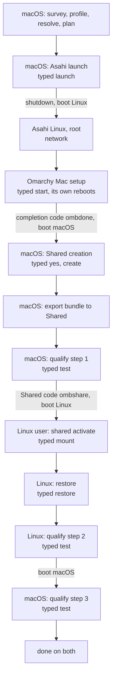

# Journey and qualification

**Status: designed for M16; not implemented.** M17, the first real install,
runs it on the target Mac. Baseline behaviour referred to here is the
accepted baseline in `MILESTONES.md`; the screens are in docs/UX.md.

The install crosses at least five reboots and two operating systems that
never run at the same time. This document covers how the tool keeps one
coherent journey across them, the automated cross-OS qualification, and the
report the real install ends with. What may cross between the systems
before and after Shared exists is in docs/MIGRATION.md → *Moving between the
systems*.

## The journey

Ten stations, the same on both systems, drawn by the frontend as the
journey rail (docs/UX.md → *The rail*); `status` prints them one per line:

```text
survey · profile · resolve · plan · asahi · omarchy · shared · restore · verify · done
```

| Stage | Runs on | Done when (read from the machine) | Skippable |
| --- | --- | --- | --- |
| survey | macOS | the survey read this Mac this run | no |
| profile | macOS | a saved profile for this Mac (docs/MIGRATION.md) | yes: "no migration" |
| resolve | macOS | every included item `resolved` or `unsupported` (docs/RESOLVER.md) | with profile |
| plan | macOS | a saved plan whose invariants hold on a fresh read of the disk | no |
| asahi | macOS, then Linux | the Asahi install classified `installed` (macOS) or Asahi Linux booted (Linux) | no |
| omarchy | Linux | Omarchy Mac finished: the baseline's marker, conf and encryption signals | no |
| shared | macOS, then Linux | Shared `created` (macOS) / `ready` (Linux) | yes: not planned |
| restore | macOS, then Linux | a bundle exported to a verified destination (macOS); the restore `complete` (Linux; docs/RESTORE.md → *States*) | with profile |
| verify | both | qualification `passed` (with Shared), and doctor has no FAIL | no |
| done | both | every stage above done or skipped | — |

The profile comes before the plan because what is coming to Linux tells the
planner how much room Linux needs: the plan screen shows the selection's
estimated size beside the Linux presets. A skipped stage shows as skipped,
never as done. The profile, resolve and plan stages may be redone before
the Asahi launch; after it, the baseline refuses a new plan (the disk no
longer matches), while the profile can still be changed and exported.

Each stage's state is `done`, `current`, `todo`, `skipped` or `blocked`, and
says where it came from: `machine`, derived on this system this run, or
`recorded`, the other system's progress as a typed code carried it (below).

### What each system can see

Each system reads only its own machine. macOS cannot read the encrypted
Linux root; Linux has no APFS access. The other system's progress comes
only from the codes the person types, each input only:

| Code | Direction | When | Carries |
| --- | --- | --- | --- |
| resume token | macOS → Linux | before Asahi | the choices and the plan id |
| completion code (`ombdone-…`) | Linux → macOS | after Omarchy Mac | Linux finished, for this plan and this Linux root |
| Shared code (`ombshare-…`) | macOS → Linux | after Shared creation | Shared created, for this plan and this partition |

A stage known only from a code is drawn as `recorded`. A code feeds checks
against a fresh read of the machine, and is never on its own the reason to
allow anything.

### Across reboots

- Every run re-derives every stage from the machine; the codes only fill in
  what this system cannot see, marked `recorded`.
- Before any reboot the tool prints what to do after it: which system to
  boot, how (Startup Options), what to run, and what will be asked. The
  Asahi installer ends in a shutdown, so that text is shown before the
  launch (baseline).
- Nothing starts by itself after a reboot. The tool installs no login item,
  unit or profile hook; the next run is always the person typing
  `./omarchy-bootstrap`. A default run offers the next step and waits for
  its typed word; a reboot never counts as consent.
- Every stage's screen answers five questions: where we are, what is done,
  what comes next, what is blocked and why, what you do now.



Without Shared, the `shared` stage is skipped, the bundle travels on
removable media, and the cross-OS round trip is not run (verify then rests
on doctor; see *Without Shared*).


## Qualification

### What it proves

That the two systems agree about the one partition they share, on this
Mac: macOS writes a file over 4 GiB and Linux reads it back bit for bit,
Linux writes one and macOS reads it back, file names survive both
directions, and each side vouches only for the partition the baseline
identified as Shared. No hash is copied by hand.

### Files

```text
on Shared:  omarchy-mac-bootstrap/qualify/
              macos.omb        step 1, macOS
              data.macos.bin   random bytes from macOS
              names-macos/     names written by macOS
              linux.omb        step 2, Linux
              data.linux.bin   random bytes from Linux
              names-linux/     names written by Linux
              result.omb       step 3, macOS
```

Nothing about qualification is kept anywhere else: each run reads its state
from this folder (*States*).

Every record is written to a temporary name with exclusive creation,
flushed and renamed into place; exFAT has no journal, and the seal catches a
record torn by a crash. The flush is `sync FILE` on Linux; macOS's `sync`
takes no file argument, so there it is a whole-system `sync`.

| Record | Written by | Schema |
| --- | --- | --- |
| `macos` (`macos.omb`) | macOS, step 1 | `schema:uint plan:hex64 shared_guid:bytes os:enum(macos) commit:hex40? at:utc bytes:uint sha256:hex64 name:bytes*` |
| `linux` (`linux.omb`) | Linux, step 2 | `schema:uint previous:hex64 partuuid:bytes majmin:id os:enum(linux) commit:hex40? at:utc read_sha256:hex64 bytes:uint sha256:hex64 name_seen:bytes* name_written:bytes* name_collision:bytes* kernel:id dirty:bool` |
| `result` (`result.omb`) | macOS, step 3 | `schema:uint previous:hex64 os:enum(macos) commit:hex40? at:utc data_ok:bool return_ok:bool names_ok:bool verdict:enum(passed\|failed) reason:id?` |

`previous` is the SHA-256 of the step record before it, so each step names
the exact file it continued from. `commit` is this tool's commit when it
can be read, and `at` the time of writing; both are shown, never compared.

### Binding and freshness

Each side checks, in this order, and stops at the first failure before
reading or writing anything else on the partition:

1. **The partition is Shared**: the baseline's identity checks, unchanged
   (macOS: the mount point diskutil reports for Shared's GUID on this Mac's
   internal disk; Linux: the mount's `MAJ:MIN` traced through `lsblk` to
   Shared's PARTUUID on root's disk). A record on any other volume is never
   opened, because this runs first.
2. **The records are admissible and whole**: docs/PROTOCOL.md → §2, and their
   seals.
3. **They belong to this install**: `plan` equals the local plan record's
   digest (macOS) or begins with the token's plan id (Linux); `shared_guid`
   equals the partition just verified; `schema` is this tool's.
4. **The steps follow each other**: step 2 requires a `macos.omb` and no
   `linux.omb` yet; step 3 requires a `linux.omb` whose `previous` is the
   digest of the folder's `macos.omb`, and no `result.omb` yet.

The folder holds one run at a time, because step 1 always starts over
(*The round trip*). Clocks are never compared: the two systems may disagree
about the time.

### The stream

Each data file is **4 296 015 889 bytes** (4 GiB + 1 MiB + 17: past FAT32's
limit and aligned to no block) of random bytes, streamed from
`/dev/urandom` to the file and never held in memory. Random bytes, not
zeros, because a filesystem that loses data can read back zeros. The writer
computes the SHA-256 of the bytes as it writes them and records it beside
the file, in its step record; the reader computes its own over the file it
reads back and compares the two. A write counts only when every command in
it exited 0, read from `PIPESTATUS` right after the pipeline, and the file's
size is exactly the size asked; otherwise the step stops. The record's seal
tells a damaged record from damaged data.

### Space

Before writing, each side requires free space on Shared of at least:
macOS, twice the stream (its file and Linux's return file) + 1 MiB for
records and names + a reserve of the larger of 1 GiB and 2 % of Shared;
Linux, one stream + 1 MiB + the same reserve. macOS measures after step 1
has cleared the folder. Too little space is `blocked`, with the numbers.

### Names

Fixed names (ASCII; a precomposed and a decomposed `é`; two names differing
only in case; a 255-byte name; a name with a space) are written into that
side's names folder, **each with exclusive creation**: a name that already
exists (on case-insensitive exFAT, the second of the case pair) is recorded
as a collision and never overwritten. Each side records what it wrote, what
it sees, and each collision, byte for byte.

### The round trip

`qualify` runs the step that is due after the typed `test`, and only once
the baseline's identity check has found Shared; on Linux it runs as the
everyday user.

```mermaid
sequenceDiagram
    participant M as macOS
    participant S as Shared (exFAT)
    participant L as Linux (everyday user)
    M->>M: identity, binding, space
    M->>S: step 1: clear the folder; data.macos.bin, names-macos/, macos.omb
    Note over M,L: clean shutdown, boot Linux
    L->>L: identity; admit and bind macos.omb
    L->>S: step 2: SHA-256 of data.macos.bin = recorded? names?
    L->>S: data.linux.bin, names-linux/, linux.omb
    Note over M,L: clean shutdown, boot macOS
    M->>M: identity; admit, bind, previous
    M->>S: step 3: SHA-256 of data.linux.bin = recorded? names?
    M->>S: result.omb
    M->>S: passed: remove the data files and names
```

- **Which step is due follows from the files present.** On macOS, `qualify`
  runs step 3 when a `linux.omb` waits without a `result.omb`, and step 1
  otherwise; on Linux it runs step 2 when a `macos.omb` waits without a
  `linux.omb`, and otherwise refuses and names the step that is due.
- **Rerunning step 1 starts over.** It first removes from the folder only
  the names this design fixes (the three step records, the two data files,
  the two names folders and the fixed test names in them), after showing
  them; anything else found there is reported and left.
- **Nothing is written before the checks.** A side that cannot verify the
  identity or the binding writes nothing on Shared, not even a failure
  record; it reports on screen and in its own log.
- **A step writes its record last.** A step that stops part-way (a command
  failed, the size is short) leaves no record, so the step is still due:
  the next `qualify` repeats it from its first check, first removing that
  side's own data file and names. A digest or a name that does not read back
  does not stop a step: it is recorded, and the result says `failed`.
- **A pass removes the data files.** After writing a passing result, macOS
  removes the two data files and the two names folders; the three step
  records stay for `report`. After a failure everything stays until step 1
  starts over.
- **Clean shutdowns**: each step ends by saying to shut down fully, not to
  sleep (docs/SHARED.md); an exFAT dirty flag seen by Linux is recorded
  (`dirty`) and shown in the verdict.

### States

Derived on every run from verified Shared and the folder on it:

| State | Meaning |
| --- | --- |
| `not-started` | no `macos.omb` in the folder |
| `waiting-for-linux` | a `macos.omb`, no `linux.omb` |
| `waiting-for-macos` | a `linux.omb`, no `result.omb` |
| `passed` | `result.omb` records a pass |
| `failed` | `result.omb` records a mismatch; the files stay until step 1 starts over |
| `blocked` | identity, admission, binding, step order or space failed; the reason is shown |

`qualify status` prints the state and writes nothing.

### Without Shared

The round trip qualifies Shared, so without Shared it is not run and the
verify stage says so; doctor alone gates `verify`.

## Real-hardware qualification (M17)

M17 is the owner's one run of the finished tool on the target Mac (2021
16-inch MacBook Pro, M1 Pro, 16 GB, 1 TB; `MacBookPro18,2`), from its macOS
restored from Time Machine to `done`. It is not a separate procedure: the
journey is the run, and `report` on each system ends it.

The owner's part is exactly: confirm the backup, choose, authenticate where
upstream or `sudo` asks, use Startup Options when told, type the disk
passphrase, boot the system the tool names, and stop when the tool says the
machine differs from what it expected.

### The report

`report` (read, either system) prints a check table from a fresh read. Each
row is pass, warn, fail or not checked, with its reason; a row this system
cannot see is not checked, and says why.

| Row | What it checks |
| --- | --- |
| the Mac | model, chip, memory, disk, macOS |
| disk | the partitions read now against the saved plan |
| Shared | created at the planned start and size; on Linux, `ready` and mounted through its PARTUUID |
| Linux | LUKS2 with Omarchy Mac's completion marker; Omarchy's version |
| qualification | the qualify result |
| restore and AI tools | restore and AI health |
| doctor | doctor's warnings |
| Recovery boot, a current backup | not checked: this tool cannot see them |

It writes nothing.
