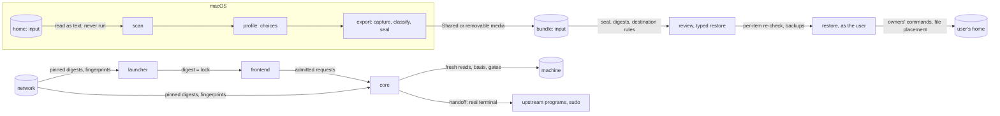

# Security

The threat model for the product expansion (M14–M16), on top of the
accepted baseline's security boundaries (SPEC.md → *Security boundaries*).
Every claim below names the mechanism that establishes it, what it does not
cover, and the tests that fail if it does not hold (docs/TESTING.md →
*Test families*); a claim whose family is planned holds once its phase's
tests exist and pass.

## Who and what

This is one person's tool on their own Mac. It is built against mistakes,
stale state, hostile *data* and hostile networks, not against someone who
already runs code as that person: such a program could do everything the
tool can, without the tool.

| Principal | Trusted to | Not trusted to |
| --- | --- | --- |
| the person | decide, type the words, sign in to their tools | remember every detail: the tool reads the machine instead |
| this repository's code | define behaviour, the child registry, the migration map, the frontend lock | — |
| upstream projects (Asahi, Omarchy Mac, Omarchy, the AI tools, package repositories) | be the authority for what they own | report success truthfully: results are read from the machine |
| the frontend binary | draw and collect input, once its digest matches the lock | assert any state, choose any action, or run anything |
| files on Shared or removable media | — | anything: input, admitted and checked before use; a bundle is used only after the bundle check, the review and the typed `restore` |
| the network | carry bytes | deliver the right bytes: digests decide |
| an agent the person starts with the `debug` brief | propose commands, which the person approves | run disk, boot or encryption commands |

**Assets:** the disk and every partition on it; macOS's data; secrets (keys,
tokens, passphrases); the everyday user's configuration on both systems;
the integrity of what gets installed; the privacy of what lands on Shared,
which is not encrypted; whether SSH can be reached with a password.

## Words

Used with exactly these meanings in every document:

| Word | Means | Established by |
| --- | --- | --- |
| **integrity** | bytes are the bytes that were written | seals and digests |
| **sealing** | a document ends with the SHA-256 of its bytes: it detects corruption, not who wrote it | docs/PROTOCOL.md → *Sealed documents* |
| **approval** | the person said this exact content may be used | a typed gate word; for a bundle, `restore` typed after the review |
| **origin** | which machine and export produced a bundle | the host and time in its sealed `bundle.omb`, shown when restore lists the bundles; a seal does not prove it |
| **authentication** | proving who someone is to a program | upstream programs and `sudo`, under their own policies |
| **authorisation** | being allowed to act: privilege | `sudo`, and the session's ceiling and scopes |
| **intent** | the person's choice of an action | the command and its typed word, validated by the core |
| **machine authority** | the machine's current state as read now | fresh reads; records are input |
| **verification** | a postcondition checked on the machine after an action | the checks each action defines |

"Trusted" is never used for "hash-consistent".

## Trust boundaries

1. **Home → scan.** Text to read, never something to run.
2. **Bundle → Linux.** Integrity by the seal and object digests; consent by
   the review and the typed `restore`; meaning by the adapters; placement
   by the destination rules.
3. **Frontend → core.** Requests from a program the core treats as input,
   admitted byte by byte before anything parses them.
4. **Core → machine.** The only place anything changes, through `run` and
   the gates.
5. **Network → anything.** Through a pinned digest (the frontend), or
   fingerprinted and shown before use (the upstream installers' scripts).
6. **Root → the everyday user.** Restore never runs as root, and nothing
   crosses from root's home.

## Claims

### The core, the protocol and the frontend

| # | Threat | Mechanism | Not covered | Tests |
| --- | --- | --- | --- | --- |
| 1 | malformed bytes normalised into a valid request, or a request that cannot say what it means | admission before any split: a bound, the byte class, termination, framing and canonical form, every tool's status, then per-operation schemas and kind-checked codes, the same in Bash and Rust | — | `proto-diff-*`, `proto-diff-chunks`, `proto-golden-*`, `proto-invalid-schemas`, `proto-op-records`, `proto-code-kind`, `proto-admit-io` |
| 2 | a frontend asserting state or skipping gates | the core re-derives and lists only what the text flow would offer now, rebuilds the basis, checks the ceiling, scopes and the typed word; schemas carry no verdicts; the session values come from the launcher | a malicious program running as the person, which needs no frontend | `proto-env`, `proto-ceiling`, `proto-scope`, `proto-word`, `proto-arg`, `actions-*` |
| 3 | a stale review executed | a basis per action — the SHA-256 of the action id and the facts its gate showed (for `plan.save`, the inputs, every partition's GUID, offset and size, and the computed plan), never free space, battery or a time — compared after the run lock and the operation record are taken and the machine is read again; free space, the resize limit and the floor are checked again at execute; the baseline's own final revalidation stays | — | `actions-*` |
| 4 | a protocol descriptor reaching a child, holding EOF open, or blocking a mutation | fd 3 closed after the bounded read; the spool is a file C opens per record, only from its main shell; every other descriptor close-on-exec; one spawning thread in F; no mutating child has a pipe | — | `sup-fd-child`, `sup-fd-grandchild`, `sup-fd3-closed`, `sup-spool-handoff`, `sup-slow-frontend`, `sup-overflow`, `sup-epipe`, `sup-one-spawner`, `diag-mutator-no-backpressure` |
| 5 | a death read as success or failure; a mutator still running when the next one starts | no `result` means unknown and a fresh read; normal completion only by the supervising core, after the child exits, no worker is still present (the controllers remaining as expected) and the postcondition holds; lost supervision is a barrier for the rest of the boot, in both interfaces, then reconciled into no effect, the expected effect, or something unexpected that stays blocked | a descendant that leaves the group is not seen by inspection: the child registry admits as managed mutators only programs that leave nothing running, or that name an owner and completion check | `sup-completion-controllers-live`, `sup-completion-worker-lingers`, `sup-identity-unknown`, `sup-core-death-mutator-live`, `sup-mutator-escaped-pgid`, `sup-mutating-daemon-classification`, `sup-unsupervised-blocks`, `sup-boot-clears`, `sup-post-reboot-reconcile`, `sup-post-reboot-unexpected`, `sup-no-reclaim-pid`, `sup-read-orphan-no-barrier`, `sup-reader-death` |
| 6 | a barrier lifted while something may still run | an operation record that cannot be read blocks every act in its scope (`refused unsupervised`) while reads keep working; `operation clear SCOPE` goes on only for `unreadable` after a fresh inspection, says what it cannot know, takes the typed `clear`, re-inspects, and renames the entry once inside `ops`, never opening, editing or deleting it; the next act's fresh read and rebuilt basis decide | whether a process this tool started still runs (a restart ends every such process), and what the operation changed | `actions-*` |
| 7 | a new wait inside Shared's critical interval | nothing added between the final topology read and `sudo -n diskutil addPartition`; the code between them is the baseline's | — | `sup-shared-critical` |
| 8 | a broken terminal; input taken from a child | saved settings restored around every handoff; one thread reads the terminal and not during a child; signal dispositions left default | recovery after every process is killed at once: the person is told what to run | `pty-*` |
| 9 | a replaced release asset, a tampered cache, a partial download | the lock pins size and SHA-256 per target; checked on download and every launch | — | `frontend-digest` |
| 10 | a frontend built from other inputs than the commit's | `inputs_digest` over every Git-tracked file under `frontend/`, read from the commit; the build closure checked from rustc's dependency files and `cargo metadata`; no build script, outside path or Cargo configuration; the lock outside the inputs; attestations link artifact and commit | the artifact digest says which bytes, not how they were built; the attestation is a record, not a run-time check | `frontend-lock-not-input`, `frontend-input-*` |
| 11 | an unreleased frontend on a real machine | the development override works only in fixture mode, never as root | — | `frontend-dev` |
| 12 | a frontend that cannot run on the target | the artifact checks (loader, libraries, glibc symbols, alignment, minimum macOS) | 16 KiB pages are proven only on the Mac, in M17 | `frontend-compat-linux`, `frontend-compat-macos` |
| 13 | a read command or dry run persisting through the frontend | the intent table (docs/FRONTEND.md → *Intent and persistence*) | — | `frontend-intent-read`, `frontend-intent-plan`, `frontend-intent-dry-run`, `frontend-intent-no-tui`, `frontend-intent-act` |
| 14 | the protocol path changing a baseline action | three-way equality with the accepted baseline `2edb76a` over its fixtures: the decisions, the argv and its order, the resulting state | behaviour the fixtures do not reach | `equiv-*` |
| 15 | a response field executed | an action id names a row of the core's action table, which runs the text flow's own functions with argument arrays; no value reaches `eval`, `source`, unchecked arithmetic or a command string; package names and MCP definitions travel as single arguments | — | `proto-no-shell-text`, `restore-*` |
| 16 | diagnostics filling the temporary filesystem, or their loss changing an outcome | the child registry classes each child; a read child drains through `tail -c`, never holding or writing more than 65 281 bytes; hard limits over every retained byte, headers and fixed-size summaries included (65 536 a child, 262 144 a request, 4 194 304 a session), reserved before appending; a saturated scope drains to `/dev/null` and adds nothing; a mutating child's output goes to `/dev/null` or its functional destination, and one that needs a terminal is a handoff; a capture failure changes no outcome | the scratch is not a security boundary, and removal is not erasure | `diag-*` |
| 17 | a session's scratch removed under a live process, or never removed | controllers and workers recorded by PID, start time and boot session, an unknown identity counting as alive; the live launcher cleans up its own scratch once its frontend, cores and workers are gone and no operation names it; a later launcher reclaims only when every recorded identity is dead, no process names the folder and no operation names it | — | `sup-owner-cleanup`, `sup-owner-cleanup-refused`, `sup-reclaim-live-controller`, `sup-reclaim-live-core`, `sup-reclaim-live-worker`, `sup-reclaim-operation-barrier`, `sup-reclaim-quiescent`, `sup-frontend-death-core-live`, `sup-pid-reuse`, `sup-identity-unknown` |

### Migration

| # | Threat | Mechanism | Not covered | Tests |
| --- | --- | --- | --- | --- |
| 18 | configuration that executes during a scan | fixed read-only utilities only: no inventoried tool runs, nothing is sourced, no hook, MCP server or plugin executes; JSON is read with `plutil` | — | `scan-*` |
| 19 | an inventory reported with false certainty | unknown, `partial` and `denied` stay visible, never an empty or short complete list | — | `scan-*` |
| 20 | Zsh code imported as data | only literal aliases and allowlisted exports become Bash; the rc files travel as reference copies, never sourced; functions are not carried as code; `PATH`, `HOMEBREW_*`, `DYLD_*` and `LD_*` never travel | — | `scan-*` |
| 21 | secrets leaving through a supported adapter | allowlisted fields first, credential fields dropped, configuration regenerated for Linux; MCP secrets and environment values travel as variable names only; the whole-file credential scan only rejects, naming the kind, never the value; the bytes classified are the bytes carried | a credential under an allowlisted field in an unrecognised form; **files carried whole** (instructions, skills, a Neovim tree) are covered only by the scan and not certified secret-free; the scan's miss proves nothing | `secret-*`, `toml-*` |
| 22 | secrets inside a chosen folder | excluded until one typed `opaque` per save, with the warning that Shared is not encrypted; known credential files refused inside | **opaque content has no secret guarantee** | `secret-*` |
| 23 | an SSH private key | travels only when its `openssh-key-v1` envelope shows it encrypted, and after the typed `carry`; `UseKeychain` lines dropped from SSH's configuration | the passphrase's strength; erasure from Shared | `secret-*` |
| 24 | Codex's or mise's configuration misread | the strict subset reader refuses the whole file on anything outside it, within its size and nesting bounds; a refused file is listed | settings in a refused file do not travel | `toml-*` |
| 25 | a corrupted, incomplete or hostile bundle | the bundle check before any use: the seal, every object's digest, plain regular hash-named objects | — | `bundle-*` |
| 26 | traversal, collisions, escaping links | the destination rules, checked for the whole bundle before anything is placed: no `..`, no absolute path, no control byte, nothing beneath a link, no duplicates | — | `bundle-*`, `restore-*` |
| 27 | a half-written bundle, or a delete driven by a marker | written as `.partial-*`, then renamed; size limits and a free-space check; export deletes nothing, and Linux deletes nothing in a bundle | — | `bundle-*` |
| 28 | a tampered or stale profile, or a malformed migration map | typed fields, admission and the seal; the profile bound to this Mac; a rescan reconciles choices by item id and reports what is gone and what is new; `data/migration-map.omb` admitted as records | — | `profile-*`, `resolve-*` |
| 29 | package substitution | explicit mappings in `data/migration-map.omb` and the person's decisions; a guess shown as a guess and checked on Linux with `pacman -Si`; no automatic AUR, no implicit build; package names passed as argument arrays | — | `resolve-*`, `restore-*` |
| 30 | steps run out of order, or versions collapsed | fixed layers in order — packages, runtimes, ecosystem tools, AI tools, files, settings; one version per runtime; an unresolved item becomes a decision | — | `resolve-*` |
| 31 | a language model deciding an install | nothing calls a model; resolution comes only from the migration map and the person's decisions | — | `resolve-*` |

### Restore

| # | Threat | Mechanism | Not covered | Tests |
| --- | --- | --- | --- | --- |
| 32 | writes as root, outside the home or through links | `EUID` 0 refused; the destination rules; a link on the path stops the item; a device check before anything is moved aside | — | `restore-*` |
| 33 | overwriting the person's or Omarchy's files | conflicts Keep by default; on Replace the original is moved aside whole into backups and compared before anything is placed; Omarchy's own files never touched | a program that keeps the old file open writes into the backup | `restore-*` |
| 34 | a stale review placed | each item re-checked just before it is placed, staged and digested, placed with no-clobber `-T` forms and read back; a changed destination stops as a conflict | a structured setting written by another program between the re-read and its owner's command is overwritten and not detected (docs/RESTORE.md → *Placing a file*) | `restore-*` |
| 35 | a stop losing track of what was done | an append-only run log per run, `sync` per line, a torn last line ignored; a rerun re-judges each item from the filesystem, so a stop resumes and a finished run changes nothing | the last line before a power loss may be missing, and that item is judged from the filesystem | `restore-*` |
| 36 | undo destroying later edits | `restore undo` acts on files, folders and links only where the destination is still exactly what restore placed | packages, sign-ins, remote effects: never reversed | `restore-*` |
| 37 | a bundle used unchecked or without consent | the bundle check before any use; the review shows what installs, where each file lands and each conflict; nothing happens before the typed `restore` | — | `bundle-*`, `restore-*` |
| 38 | an AI tool's wrapper or agent run by a check, a second copy, a helper's false success | `lib/agents.sh` observes from files only, its one run `mise x <tool> -- <tool> --version`, with a timeout, right after installing; `mise use -g`, one copy each; every install judged by the machine afterwards (`pacman -Q`, never an exit status); `omarchy-default-agent` never run; sign-in files never read | — | `agents-*` |

### Debugging and SSH

| # | Threat | Mechanism | Not covered | Tests |
| --- | --- | --- | --- | --- |
| 39 | secrets in the debug report | `debug` holds the fixed agent brief and the status and doctor facts: never a log line, journal line, command output or file content; a root line only when run as root | what the person adds beside it | `debug-*` |
| 40 | password SSH left listening | before Omarchy Mac's setup, `start` runs `systemctl disable --now sshd`, checks `is-active` and `is-enabled`, and reports a failure; `doctor` classifies SSH from `sshd -T` as root (off, key-only, accepts passwords, cannot tell), names the `alarm` password and prints `sudo passwd -l alarm` | firewalls are neither assumed nor changed; SSH turned on later through `dev` is the person's choice | `ssh-*` |

### Qualification

| # | Threat | Mechanism | Not covered | Tests |
| --- | --- | --- | --- | --- |
| 41 | the wrong partition | the baseline's Shared identity check runs before any file is opened or written | — | `qualify-*` |
| 42 | a failed, short or changed write passing | the SHA-256 the writer computed is recorded with the data; the other system checks size and digest before it writes its own; which step is due follows from the files present, and rerunning step 1 starts over | — | `qualify-*` |
| 43 | a test overwriting files | its files only in one folder, `omarchy-mac-bootstrap/qualify/` on Shared, created exclusively; a pass removes the data files | — | `qualify-*` |

## Deliberately not built

Each of these was weighed against a concrete moment in this Mac's use and
not found one:

- **Signatures or keys** for profiles, bundles or records. Seals catch
  corruption; the typed `restore` after the review is the person's word;
  anyone able to forge a record on this Mac could change the machine
  directly.
- **Approval codes** for bundles. Nobody but the owner's two systems writes
  Shared; the seal and object digests catch corruption; restore lists the
  bundles it finds with their origin and time, and the typed `restore` after
  the review is the consent.
- **Foreign bundles.** Restore is for bundles this person's own Mac
  exported; there is no path for one made on another machine.
- **An encrypted secrets bundle.** Tokens are cheaper to renew by signing
  in once; the one secret that may travel (an SSH key) is encrypted by its
  own format.
- **Tamper-evident logs**, audit trails, review chains. The restore run log
  exists so that a stop can be resumed, not as evidence of anything.
- **A daemon, an updater, telemetry, any cloud service.**
- **A rescue mode**: no agents as root, no rescue SSH server, no workspace.
  Recovery help is docs/TROUBLESHOOTING.md and the `debug` brief, which the
  person can hand to an agent they run and approve themselves.
- **Firewall changes.** `start` turns off the image's password SSH instead,
  and `doctor` says what SSH accepts.
- **A forced second password prompt** before Shared's creation: the typed
  words are the intent, `sudo` is privilege (docs/DECISIONS.md →
  *Rejected*).
